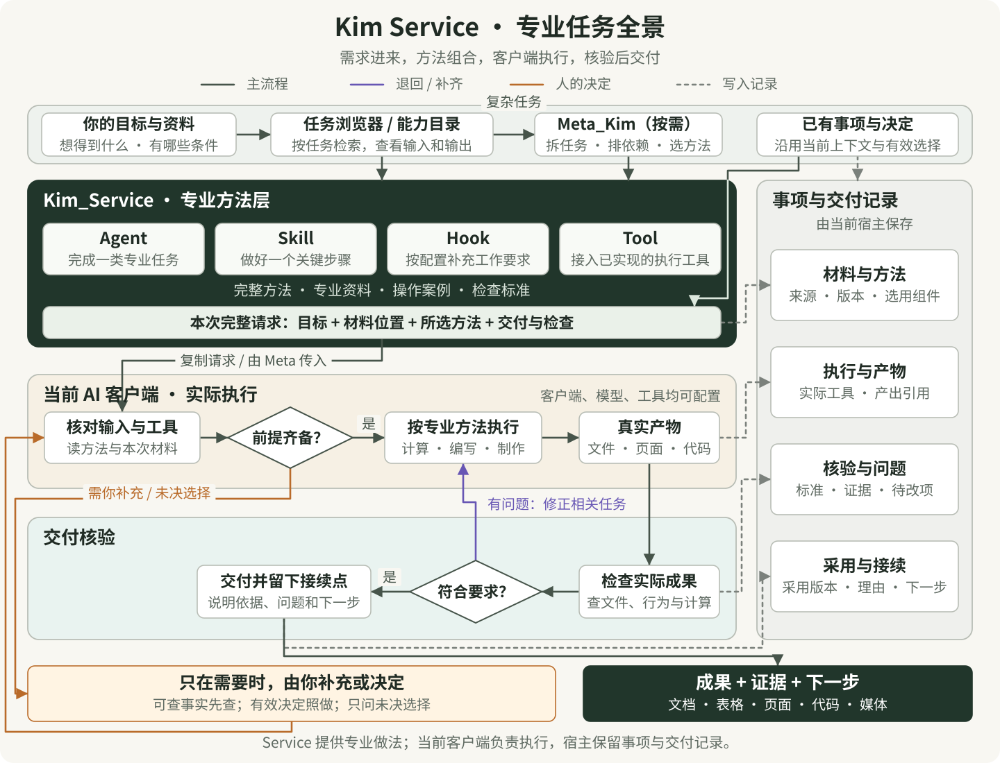
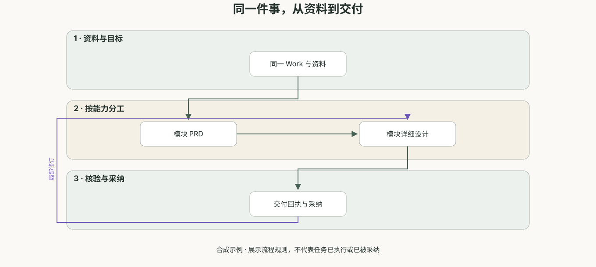
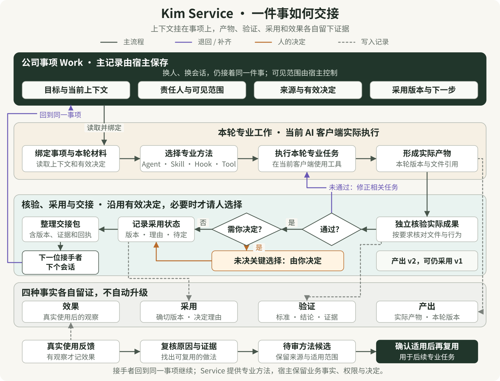

# Kim Service

<p align="center">
  <a href="README.md">简体中文</a> · <a href="README_EN.md">English</a>
</p>

**把专业工作的做法交给 AI，把能打开、修改和检查的成果交给你。**

你知道想做什么，却未必知道一份经营预测要核对哪些数据、一个页面要补齐哪些状态，或一份供应商比较该怎样算成本。Kim Service 把这些工作需要的方法、材料、步骤、例子和验收标准放在一起，让你和 AI 有一套具体的做事依据。

当前主分支包含 **58 个专业 Agent、30 个 Skill、2 个 Hook 和 2 个 Tool**，共 92 个组件，提供 **107 项可搜索的任务能力**。你可以只选一个解决眼前的问题，也可以让几种方法围绕同一个项目配合。

**[打开能力目录与请求准备页](https://kimyx0207.github.io/Kim_Service/?lang=zh-CN)** · **[下载 V1.15 源码与安装包](https://github.com/KimYx0207/Kim_Service/releases/tag/V1.15)**

<p align="center">
  
</p>

从顶部的目标与资料进入，沿深色箭头看方法如何组成请求、客户端如何执行、成果如何核验。复杂任务可接入 Meta_Kim；紫线把问题送回相关任务，橙线只在必要时请你补充或决定，灰色虚线指向宿主持有的记录。客户端、模型和工具分别配置，Service 提供方法、资料、示例和检查标准。[打开可缩放的全景图](docs/images/service-system-panorama.zh-CN.svg)。

## 它怎样帮助你把事情做扎实

专业工作经常卡在中间：资料口径没统一，结论缺少依据，页面只考虑正常输入，或者交付文件拿回来打不开。Kim Service 把这些容易遗漏的部分写进每个方法包，带着 AI 从材料检查走到交付核验。

例如，财务建模会先核对期间、币种和单位，再把销量、单价、成本、回款连接到利润与现金；设计系统会把颜色和字号整理成可复用的设计变量，同时处理焦点、报错、加载、长文本和主题切换。方法包还说明哪些结果需要重做、用什么证据判断，以及材料不全时哪些工作可以先完成。

### 四类组件，分别解决什么问题

- **Agent：把一类专业工作做完整。** 58 个角色各有自己的任务范围、输入输出、专业资料、决策步骤、正反例和质量检查。你交给财务建模的是经营资料，交给设计系统的是页面、品牌与交互要求；两者按各自的方法产出模型或页面规范。
- **Skill：把某一步做得更稳。** 30 个可复用技能覆盖需求追踪、API 合同、数据迁移、无障碍检查、财务情景、实验分析、检索评估、教学测评，也包含团队协作、记忆、技能发现、小红书与贴纸制作等工作流。同一个项目可以按需组合几项。
- **Hook：在提出需求时补好工作要求。** HookPrompt 补充目标、范围、输出和检查要求；新增本地回执 Hook 在配置后记录选定产物的版本。两者各司其职，保留对话里已经确定的选择。
- **Tool：接上实际执行工具。** 多 CLI 工具包可把本机已安装的 Codex、Gemini 接入支持 MCP 的客户端，用于代码工作或复核，并提供项目级工作流入口。新增的 MCP 契约审计工具离线检查工具定义变化。实际运行范围和文件操作仍由当前客户端管理。

它们可以这样配合：专业 Agent 判断任务该怎么做，相关 Skill 提供某一步的做法，Hook 帮助表达需求，工具承担实际操作。你只需要加载与当前任务有关的部分。方法包中的说明、参考资料、案例和检查脚本都随源码保留，成果可以追溯到用了什么材料、做过什么检查。

<p align="center">
  
</p>

**先确定要交付什么，再选择这次需要的组合。** 做一次经营预测，可以直接让 AI 读取财务建模方法；要细化压力情景，再读取相应 Skill。Hook 适合反复整理工作要求，Tool 适合接入已经具备的执行工具。安装哪个、加载多少，取决于本次任务和客户端，不需要把全部组件一次全装上。

<a id="capability-directory"></a>

## 哪些工作可以从这里开始

**做产品、网站或应用时，** 可以从用户研究和最小产品范围开始，再推进交互、品牌与设计系统、前后端、移动端、AI 应用和数据管道。已有产品也能用同一套入口安排自动化测试、安全复核和可靠性改进。交付会落到方案、接口、代码、页面与检查记录，方便下一位接手。

**经营店铺、销售或创业项目时，** 可以带来 SKU 销售表、客服问题、供应商报价、库存和成本资料。先解释变化、统一可比口径，再做商品文案、客户回复、采购比较、补货计划、销售预测或定价测算。比如比较供应商，会把起订量、运输等到货成本和交期放在一起，说明缺失条件如何影响选择。

**看经营财务和投资研究时，** 可以核对账目、解释预算差异、做现金预测、项目估值与压力情景，也能整理投资资料或审查量化回测中的假设。你拿到的是可追到输入的计算、情景比较、关键假设与待核事项，供有权限的负责人做决定。下面的经营预测就是一个完整起点。

**做内容、营销和日常协作时，** 可以从受众与选题走到正文、口播、分镜、标题、封面和媒体制作，也可以把散乱进度整理成邮件、周报或操作流程。求职、招聘和教学同样有对应方法：岗位匹配与面试练习、结构化招聘标准、课程流程、知识讲解、练习与学习评估，都有明确的输入和可用产物。

**推进线下运营和工程项目时，** 可以整理制造质量、系统需求与接口、建筑信息、能源项目、碳核算、农田水量以及医疗机构的非临床服务流程。方法会把边界、数据来源、单位、异常和现场待核条件说明白，交付分析、验证安排或试点方案；需要现场资料和专业判断的部分会继续标明。

107 项能力是现有任务入口的覆盖范围。选择时先想清楚“我现在要得到什么”，在浏览器搜索这个结果，再看需要提供哪些材料。你不用先记住角色的英文名字。

<a id="task-browser"></a>

## V1.15 新增的专业行业方法

这次补的是具体业务问题。每个新 Agent 都有材料口径、判断分支、完整交付模板、可接受与拒收案例，以及逐项检查依据。角色入口只保留本次工作需要的说明，详细资料按需读取。

| 在目录里搜索 | 带来什么材料 | 要交付什么 |
| --- | --- | --- |
| 信用风险 | 贷款敞口、还款与逾期记录、假设及其来源 | 信用风险拆解、预期损失情景和待核证据 |
| 资金流动性 | 可用现金、收付款时点、融资约束 | 分期限现金缺口、压力情景和资金安排候选 |
| 保险理赔 | 保单版本、损失材料、免赔与限额 | 证据对应、条件赔款复算及争议事项 |
| 合同审查 | 完整条款、附件、交易目标和适用范围 | 条款义务表、风险依据和修改建议 |
| 设备维护 | 设备台账、故障停机、维修与测量记录 | 可靠性指标、故障判断和维护方案 |
| 仓储运营 | 库存、预留、收发记录、库位与作业约束 | 可承诺库存核对、作业瓶颈和改善方案 |
| 建筑项目 | 工作分解、基线、实际进度、成本与变更 | 进度成本偏差、变更影响和恢复方案 |
| 酒店收益 | 房量、价格、取消、渠道费用和需求 | 净收益比较、库存与价格方案及敏感性分析 |
| 游戏经济 | 货币来源与消耗、奖励、物品和玩家分层 | 货币收支、通胀风险和可验证的经济调整方案 |
| 安全事件 | 已授权的告警、日志、时间线和资产范围 | 证据时间线、影响范围及处置与恢复方案 |

在上方目录搜索中文业务词，查看“你提供”和“会交付”，复制请求到能读取仓库和材料的客户端即可。材料不全时先完成有依据的部分，保留影响结论的缺口。合同结论、信贷决定、理赔决定或生产处置由当前业务责任人负责；示例不是实际业务结论。

### 同时补进来的 Skill、MCP 与 Hook

| 能力 | 实际用途 |
| --- | --- |
| 数据血缘与变更影响 | 沿已有数据依赖寻找受影响的表、字段和任务，保留影响路径 |
| 库存补货 | 按需求、提前期、服务水平和包装约束复算补货候选 |
| 故障复盘 | 核对事件时间线、影响与后续行动，检查行动是否有负责人和验证方法 |
| 招投标响应核查 | 把招标要求逐项关联到响应、证据和缺项，区分硬性要求与可说明事项 |
| MCP 契约审计 | 比较工具清单、输入输出定义和风险提示的变化，形成离线检查结果 |
| 本地交付回执 Hook | 对明确选定的文件记录哈希，供交接时核对产物版本 |

前四项 Skill 和 MCP 审计工具均提供可运行的合成输入与本地脚本，沿用下方统一机器接口。MCP 审计不连接远端服务器、不替代权限控制；Hook 需按包内说明接入支持的客户端，只记录指定本地文件，不自动外发或改写宿主配置。

方法参考包括 Apache Fineract、Open Source Risk Engine、openIMIS、CUAD、ERPNext、OpenProject、QloApps、Nakama、DFIR-IRIS、OpenLineage、Google SRE、OCDS 与 MCP 官方资料。具体吸收点、未引入内容、版本与许可证分别保留在新包的 `PROVENANCE.md`，汇总见[行业方法吸收记录](docs/research/industry-agents-2026-11-13.md)与[技能及接口吸收记录](docs/research/skills-integrations-2026-11-13.md)。原创方法和合成案例可用于检查流程；真实专业效果仍以本次任务的实际产物和审查为准。

## 统一驱动入口与项目协作能力

**需要持续推进项目时，从 Meta Live 发起；Kim Service 提供可选择、可执行、可核验的能力。** Meta Live 保留事项和接续状态，当前宿主按实际绑定调用方法或本地 helper。Service 的在线或离线浏览器用于查目录、准备材料和整理请求；它不另起一个持续调度器。单独使用时也可以直接运行下面的 helper。

| 任务 | 你提供 | 实际得到 | 保留的边界 |
| --- | --- | --- | --- |
| [大材料证据包](skills/evidence-pack/) | 公司/事项、显式材料目录、UTF-8 原文文件、版本和预算 | 原文完整保留的文件包、来源与分块哈希、分页索引、有限上下文 | 默认 stdout 不回传整本材料；PDF/OCR 提取需由已有工具另行完成 |
| [跨客户端离线评测](skills/agent-evaluation/) | 固定案例、各客户端已有输出、关键断言、实际成本/延迟记录 | 逐题对比、缺失分母、关键回归、分层结果和预算检查 | 不调用模型；没有记录的费用保持未知，语义质量另核 |
| [反馈转需求](skills/feedback-to-requirements/) | 同一项目的反馈、明确重复关系、分组和来源 | 独立客户计数、矛盾材料、可追踪的需求候选与版本绑定采纳 | 不擅自推断语义重复；候选未采用前保持 proposed |
| [客户事项推进](skills/customer-case-operations/) | 可配置阶段、成员角色、材料、事件与决定回执 | 状态投影、缺项、下一步建议、独立的验证/收到/采纳记录 | 不发通知，不代替组织身份鉴权，不运行后台定时任务 |
| [分阶段图解](skills/visual-explainer/) | 来自真实说明的阶段、节点、连线、分支与返回路径 | SVG、可逐步播放的 HTML、文字替代说明 | 本版为有界分层布局；动画只是说明，不是执行回执 |

这五项都有可运行脚本、输入输出 schema、独立容量配置、合成示例与失败反例。它们复用现有证据分析、检索评价和交付核验职责；新增的是具体计算与材料处理能力。方法吸收参考 [Docling](https://github.com/docling-project/docling-core)、[Promptfoo](https://github.com/promptfoo/promptfoo)、[Fider](https://github.com/getfider/fider)、[Chatwoot](https://github.com/chatwoot/chatwoot)、[Slidev](https://github.com/slidevjs/slidev)，逐包记录采用范围与许可证。Fider 仅参考方法，未复制 AGPL 源码；Chatwoot 企业功能未引入。

**分阶段图解的实际输出。** 下面由正式 helper 生成的合成示例，展示同一事项如何从资料进入模块设计，再到核验与采纳；紫色回路说明局部修订。顶部和底部节点居中，三个阶段既能合起来看，也能逐步展开说明。

<p align="center">
  
</p>

[下载中文交互 HTML](docs/examples/visual-helper/zh-CN/storyboard.html?raw=1) · [文字替代说明](docs/examples/visual-helper/zh-CN/alternative.txt) · [对应输入 JSON](docs/examples/visual-helper/zh-CN/input.json)

把 HTML 下载后用本地浏览器打开，即可上一阶段、下一阶段、播放或显示全图。若打开的是 GitHub 文件页，点击 **Download raw file** 保存文件；源文件页本身不播放交互。HTML 已内嵌 SVG、样式和脚本，无外部依赖。图中内容是合成演示，动画不表示实际运行状态、验证通过或已经采纳。

从仓库根目录可以先运行不收费的合成示例：

```sh
node skills/agent-evaluation/scripts/run.mjs --input-json - < skills/agent-evaluation/examples/input.json
node skills/feedback-to-requirements/scripts/run.mjs --input-json - < skills/feedback-to-requirements/examples/input.json
node skills/customer-case-operations/scripts/run.mjs --input-json - < skills/customer-case-operations/examples/input.json
node skills/visual-explainer/scripts/run.mjs --input-json - < skills/visual-explainer/examples/input.json
```

想直接打开图解文件，可运行 `node skills/visual-explainer/scripts/example.mjs /absolute/path/to/new-diagram-folder`，然后打开该目录里的 `storyboard.html`。

大材料请使用文件式入口。下面会在你指定的新目录中建立合成材料和完整证据包，只把有限索引、哈希与上下文送回终端：

```sh
node skills/evidence-pack/scripts/example.mjs /absolute/path/to/new-example-workspace
```

真实材料按包内示例填写 `workspaceRoot`、源文件相对路径和新 `packPath`，交给 `scripts/files.mjs --input-json -`。后续只提交证据包路径、上次返回的文件哈希与分页游标或块 ID；原文不需要反复塞进请求。默认核对原文件变化，完整文件始终可重新组合还原。

### 给 Meta Live 与其他宿主的机器接口

```sh
node scripts/service-capabilities.mjs export
```

此命令实时读取组件 `capability.json`，导出 `kim-service-capabilities-v1`。已有能力继续保留；可直接调用的十项带 `kim-service-helper-v1`、固定参数数组、schema/policy 路径与哈希。宿主只能调用已绑定的本地入口，不能执行材料里的命令；客户端与模型由当前任务配置。输入公共上下文为 `organizationId / workId / revision`，结果保留输入与规则哈希，最终采用仍由宿主记录。[接口与验证说明](docs/service-helper-api.md)。

## 从第一次使用，到完成一个任务

### 先把仓库和材料交到 AI 手里

在线浏览器可以直接打开，也能切换中文或英文。它负责选任务、填写要求和整理请求；实际处理文件、计算或改代码，发生在你复制请求之后使用的 AI 客户端里。

从页首下载入口取得源码并解压，或在电脑上运行：

```sh
git clone https://github.com/KimYx0207/Kim_Service.git
cd Kim_Service
```

在 Codex、Claude Code、Cursor、Gemini CLI 等能读取项目文件的客户端中打开这个目录；如果工作项目在别处，把 Kim_Service 的完整目录位置告诉 AI，并让它同时能访问本次材料。使用只支持上传文件的聊天界面时，需要附上选中方法的入口、它引用的资料和你的任务文件。

下载后，直接用浏览器打开 `docs/start.html`，也能离线选任务。两个互动示例的本地 `index.html` 可以直接打开，不需要先搭服务器。运行包内计算或开发脚本时，再使用相应的 Node.js、Python 和客户端工具。

### 例一：未来一年，利润增长时现金够用吗？

先拿合成数据练一遍，再替换成自己的业务。这个例子会把选任务、准备材料、实际执行、交付检查和下一轮调整连起来。

<p align="center">
  
</p>

**第 1 步：从一句话找到对应任务。** 先把问题说清楚：“明年利润看着在涨，现金够不够？”在任务浏览器搜索“经营预测”，打开财务建模。浏览器按任务说明、输入输出和已有别名检索，你可以先比较任务卡上的“你提供”和“会交付”，判断它是否适合这次问题。

<p align="center">
  
</p>

**第 2 步：先看示例，再核对自己的材料。** 任务详情列出所需输入、交付内容、方法入口和示例。第一次使用仓库中的 `agents/financial-modeler/examples/operating-forecast/sample-data.js`，其中已经声明销量、价格、成本、期初资金、回款比例和设备支出，金额是 CNY，全部为合成示例。做自己的业务时，用实际报表与假设替换，明确期间、币种和缺失项。材料栏用于说明文件在哪里，还需要让 AI 能实际读取这些文件。

**第 3 步：选用方法，把这次要求交给 AI。** 选择你正在使用的 AI 客户端，目标写成：“比较未来 12 个月的基础、乐观、保守情景，找出现金紧张的月份，交付可编辑输入、月表和一份说明。”再填材料位置。页面把方法入口、输入和交付要求整理成完整请求，你可以展开修改，然后点击复制，粘贴到已经打开仓库的客户端。单次任务直接读取方法就能开始；准备反复使用时，再按下文的 DSH、ZCode 或当前客户端方式安装。

<p align="center">
  
</p>

**第 4 步：让 AI 按方法处理，看到实际计算。** 这时 AI 才开始读取材料、统一口径、连接收入与现金、比较三种情景。你可以在完整请求后补上下面这段，把执行和结果说清楚：

```text
请读取 agents/financial-modeler/AGENT.md，以及它引用的 method.json 和本任务所需资料。
使用 agents/financial-modeler/examples/operating-forecast/sample-data.js 的合成数据，完成未来 12 个月经营预测。
核对期间、币种和单位，解释利润与现金为什么不同；比较基础、乐观、保守三种情景。
请实际运行当前环境可用的计算，交付可编辑输入、计算结果 JSON、月度 CSV 和说明。
逐项列出检查结果、文件打开位置与未完成项；需要补充的数据请单列为假设。
```

**第 5 步：打开成果，动手验收。** 下面是随仓库提供的可操作样板，用来体验这种交付。在线打开，或在本地打开 `agents/financial-modeler/examples/operating-forecast/index.html`；修改售价、销量或回款比例，查看三种情景与月末现金曲线，下载输入、结果 JSON 和月表 CSV。

<p align="center">
  
</p>

**[亲手试试经营预测](https://kimyx0207.github.io/Kim_Service/agents/financial-modeler/examples/operating-forecast/index.html?lang=zh-CN)**

实际任务交付后，先核对输入与原始材料，再抽查一个月的“期初现金＋流入－流出＝期末现金”，确认设备支出和回款时间进入模型。检查三种情景究竟改了什么；从交付目录实际打开 JSON、CSV 和说明，确认别人也能使用。这个样板展示经营利润与现金，估值或完整三表需要按任务另外补齐。

如果发现问题，先定位它出在哪一步：文件打不开就修交付路径或格式，现金不平就回到输入与公式，材料缺失就把对应假设列出来。让 AI 修正受影响的结果，再按同样的方法复查。已有充分依据的部分可以继续。

**第 6 步：留下这一轮成果，接着迭代。** 把输入、结果、解释和检查记录保存在这次项目的交付目录，记下确认过的假设、待核项和下一步。下次可以对 AI 说：“保留其他假设，把当月回款从 65% 改成 45%，重新计算三种情景，解释哪些月份受影响，并保留上一版。” 图中的回路线就表示这一轮：改输入，回到计算，复查受影响的结果。后续任务沿用同一套方法和实际文件。

### 例二：把预约页面做成一致、可继续开发的设计

任务可以这样说：“把这一个预约台的按钮、表单和列表统一起来，支持浅深主题和大字号，补齐报错与失败恢复；保留已有字段，先在这一页试用。”

给 AI 当前页面、品牌色、实际文案、使用设备和技术限制；第一次可使用 `agents/design-system-designer/examples/service-console/` 下的样板。请它读取设计系统角色的 `AGENT.md` 和所引用的方法，整理颜色、字号、间距的共同规则，定义组件状态，再在这个页面里实现与检查。

<p align="center">
  
</p>

**[亲手试试预约台](https://kimyx0207.github.io/Kim_Service/agents/design-system-designer/examples/service-console/index.html?lang=zh-CN)**

也可以本地打开 `agents/design-system-designer/examples/service-console/index.html`。切换主题、品牌色、字号和密度，看看整页怎样一起变化；故意漏填或输错，再体验一次模拟提交失败和恢复。示例预约使用合成记录，便于反复试。

这次希望拿到的是：可编辑的页面源码、可导出的设计变量 JSON、组件正常与异常状态说明，以及从旧页面迁移的安排。验收时用键盘走完表单，检查错误是否说得清楚、失败后输入是否保留、长文字和手机宽度是否可用，再检查中英切换与浅深主题。下一轮可以只调整“紧凑布局在手机上太挤”，沿用已定规则继续改。

### 写到一半，怎样继续

每项任务单独保存草稿。刷新后可以继续；换设备前点“下载草稿”，在另一处打开同一项任务后导入。你手动修改过请求时，表单变化会保留手写内容；需要重建时点“按表单重新生成”，还可以“恢复上一版”。浏览器不能保存或空间不足时，先下载草稿，保住当前编辑。

大型材料超过内联预算时，请求会改为文件引用，并显示“下载完整材料”入口。原文完整保留；把下载的文件附加到当前 AI 对话，或放入 Agent 可读取的工作目录，再让它按当前模块读取相关章节。页面不会上传文件。草稿只保存一份材料，自动请求在恢复时重建；手写请求和撤销版本保留。内联预算和草稿导出、导入的共同上限统一配置在 `config/task-browser.json` 的 `contentPolicy`，当前分别为目标 4 KiB、材料 16 KiB、草稿 16 MiB。超出草稿上限时，页面保留当前编辑并提示先下载完整材料、另存手写请求，再用文件引用整理草稿，不会生成无法重新导入的导出文件。

## 单独使用，或让 Meta_Kim 组织整个项目

**一个明确任务，可以直接用 Kim Service。** 比如修改简历、比较报价、完成上面的预测或设计试点：你选择方法、提供材料，当前 AI 客户端执行，再由你检查交付。专业 Agent、需要的 Skill 和实际工具围绕这一项工作配合。

**多个相互衔接的任务，可以配合 Meta_Kim。** 比如把预约台做成一个产品：先确定用户需求和功能范围，再统一设计、实现前后端、测试交付，下一次对话还要接着改。Meta_Kim 负责组织这些步骤、分配能够并行的工作、保留决定与进度、审查交接；Kim Service 提供每一步需要的专业方法和资料，AI 客户端承担实际操作。

<p align="center">
  
</p>

**看这张图时，顺着同一个预约项目走。** 两轮设计逐步展开同一份 PRD：第一轮先确定预约、时段、记录等模块及共同约定，第二轮逐个写清输入字段、页面状态、接口和验收要求。Meta 在调研时发现已有方法，在设计时选定本轮需要的组合：页面可用设计系统、前端方法，接口可用后端与数据方法。进入执行阶段，再把选定的方法和具体工作交给当前客户端的执行者。

有共同依赖的部分先完成约定，独立部分才并行。如果中途新增一个预约字段，需要确认它的含义，受影响的接口先等待；页面样式、与该字段无关的错误提示仍可推进。字段明确后接续工作，最后把页面和接口接起来，实际完成一次预约，检查异常情况，再保存决定、成果和下一步。这就是图中“分开做、局部等、再汇合”的含义。

Service 为这条链提供可读取的专业方法、材料说明和检查标准。Meta 负责任务顺序、方法选择和交接，客户端负责实际工具调用与并发执行；一次检索命中后，还会核对方法是否符合当前范围、材料是否可读、所需工具是否可用，再开展相应工作。

**先让 Meta_Kim 找到这份 Service。** 如果使用 Meta_Kim 安装器已登记的受管理 Service 源码，可以直接使用该安装来源。自行下载两个仓库时，需要明确绑定；把文件夹放在一起不会自动接入。在你实际工作的项目根目录创建或编辑 `.meta-kim/local.overrides.json`，保留已有字段，加入：

```json
{
  "dependencyRoots": {
    "kim-service": "/absolute/path/Kim_Service"
  }
}
```

把路径替换成自己的 Kim_Service 完整路径，Windows 可以写成 `C:/work/Kim_Service`。如果文件原来已有 `dependencyRoots`，只补其中的 `kim-service`，不要覆盖其他配置。

也可以在启动 AI 客户端的同一终端设置 `META_KIM_KIM_SERVICE_ROOT`：macOS/Linux 使用 `export META_KIM_KIM_SERVICE_ROOT="/absolute/path/Kim_Service"`，PowerShell 使用 `$env:META_KIM_KIM_SERVICE_ROOT="C:/work/Kim_Service"`。环境变量优先于项目配置；路径失效时先修正该路径，系统不会悄悄换成另一份副本。

接着，在已接入 Meta_Kim 的项目里打开客户端，在任务浏览器选择 **Meta_Kim**，复制带 `/meta-theory` 的请求，并说明业务材料的位置。让它先确认发现的 Service 路径和本次选中的方法，再开始任务。随后从整体结果检查各项工作是否接上：设计是否符合需求、实现是否遵守设计、测试是否覆盖用户流程。仅安装方法包不会增加客户端原本没有的浏览器、文件或外部系统权限。

需要这个整体工作方式时，可以使用 [Meta_Kim](https://github.com/KimYx0207/Meta_Kim#readme)；继续只做一个任务，也能使用这里完整的方法和示例。

## 一件公司的事，跨会话、跨成员继续

<p align="center">
  
</p>

先看顶部由宿主持有的 Work，再顺着本轮执行、核验、采用记录和交接包回到同一事项。底部四项是独立事实：产出 v2、验证通过、继续采用 v1 可以同时成立；采用未定就保留待定，没有真实使用观察就保留未知。只有必要的未决关键选择进入橙色分支，已有授权和有效决定继续沿用。反馈经过复核和适用性判断后才用于后续任务。[打开可缩放的交接图](docs/images/service-work-handoff.zh-CN.svg)。

公司现在只有一个人，也需要保留下一位同事能接住的工作现场。宿主把目标、来源、当前采用版和决定挂在同一个 **Work（业务事项）** 上；会话和执行可以有很多次，Service 沿用这个引用提供专业方法。公司资产、个人偏好和敏感决策的可见范围由宿主已有授权决定。

<p align="center">
  
</p>

| 已有方法 | 本次补齐的具体工作 |
| --- | --- |
| [agent-teams-playbook](skills/agent-teams-playbook/) | 用可选 WorkContext 关联同一事项的分工、来源和版本，交接含范围、采用稿、下一步与接手回执 |
| [sop-runbook](skills/sop-runbook/) | 把产出、核验、采用、效果分别写进现有规程与交付；人工选择有确切版本、理由或 unknown |
| [memory-3layer](skills/memory-3layer/) | 保留成功、失败、拒用、适用/不适用、过期条件及实际复用反馈；先作为公司内部候选复查 |
| [delivery-verifier](agents/delivery-verifier/) | 可选 work_handoff 实读文件、核版本/hash、事项/context/run、采用观察与接手一致性 |

例如，课程资料本次生成了 v2，技术检查通过，但负责人仍沿用以前已采用的 v1。交接时两版分别标清；原有效决定继续引用，不请人再批一遍。收到通知不等于接手，接手不等于办完；没有业务效果证据就保留 unknown。拒用新稿的原因也可成为经验候选。

从仓库根目录运行完整本地合成演示：

```sh
node agents/delivery-verifier/scripts/demo-work-handoff.mjs
```

演示包含上述正例、失败/拒用/未知例、旧上下文回执和采用版本偷换两个反例。它实际创建临时文件并调用只读核验器，证明列明的本地一致性行为；真实人员、采用来源、线上宿主和业务效果仍未验证。完整字段与边界见 [delivery API](agents/delivery-verifier/docs/delivery-api.md)。

已有独立任务没有 WorkContext 时继续原有用法。Service 不新增业务数据库、调度、组织权限或审批；公司私有经验先留内部，通用方法经过脱敏、泛化与针对性验证后再按已有授权准备公共版本。自动检索适用条件、定时整理及对外消息都由宿主已有能力执行。

## 按你使用的客户端接入

**专业方法不指定你必须使用哪家模型。** 客户端、模型、可用工具分别由当前任务和宿主配置决定。Claude Code、Codex、Gemini CLI、ZCode、MiniMax Code 或其他能读取方法资料的客户端，可以按自身能力使用同一份方法。任务浏览器的客户端列表统一来自 `config/task-browser.json`；选择“我正在用的 Agent”可直接沿用现有环境。

| 项目 | 配置与行为 |
| --- | --- |
| 任务浏览器客户端选项 | 根据配置生成请求文本；选择名称不会启动客户端、连接账户或切换真实模型 |
| 专业执行与独立评审 | 沿用宿主工具和模型配置；角色职责不固定绑定某一品牌 CLI，重试依据进展、证据与任务预算 |
| 团队方法安装 | 显式 `--target` 优先，其次 `AGENT_TEAMS_INSTALL_TARGET`；均未提供时显示用法，不默认写入 Claude 目录 |
| 其他客户端的 Skills 目录 | `--target custom --skills-dir /absolute/host/skills` 只安装通用方法包；目录由宿主提供，原生加载需在该客户端核实 |
| Memory 的客户端与模型来源 | `MEMORY_HOST` 或载荷中的 `runtime / host / client` 标识宿主；模型单独记录，缺少宿主声明时保留 `manual` |

例如，客户端声明为 Claude Code、模型标签为 MiniMax 时，会分别保留两者；只有一个模型名时不会反推客户端。载荷自报模型仍标为未验证，不作为真实模型调用证据。账户连接、模型权限和工具 schema 由宿主提供；可选多 CLI 工具只通过已实现的适配器传参，未填写模型时沿用对应 CLI 配置。

### 普通项目客户端

Codex、Claude Code、Cursor、Gemini CLI 等客户端，按上面的方式打开仓库或读取指定包即可开始。明确告诉 AI 使用哪个角色、先读取哪些材料、把成果放在哪里，比一次性塞入整个目录更容易核对。常用的 Skill 可以再按客户端支持的技能安装方式启用，并保留它的整个资源目录。

HookPrompt 和多 CLI 工具是按需接入的组件。需要它们时，让 AI 读取 `hooks/hookprompt/README.md` 或 `tools/claudecode-codex-gemini/README.md`，按当前客户端配置并检查实际加载结果；第一个专业任务可以直接使用前面的仓库读取方式。

<a id="dsh"></a>

### DSH（DeepSeek Harness）

DSH 里，专业 Agent 方法和 Skill 会作为原生 Skills 被发现，并保留完整方法、知识、案例、脚本与许可。当前适配依据 DSH **0.2.2-rc.1**，需要 **Node.js 24.9.0+**；先准备好 DSH 自己使用的模型和工具配置。尚未安装该客户端时，可运行：

```sh
npm install --global @deepseek-ai/dsh@0.2.2-rc.1
```

**准备 Service 包。** 在页首发布下载中选择 `Kim_Service-DSH-V1.15.zip`，解压并记住包含 `dsh-package.json` 的目录。也可以在 Kim_Service 仓库构建，下面的输出路径要换成自己的完整路径，且目录尚不存在：

```sh
node scripts/build-dsh-package.mjs --output "/absolute/path/kim-service-dsh"
node scripts/build-dsh-package.mjs --output "/absolute/path/kim-service-dsh" --check
```

**安装到 DSH 并核对。** 这条接入由 Meta_Kim 的安装器管理。已有 Meta_Kim 源码的用户直接进入它的目录；没有时先下载，再执行安装。下面选择的是多个项目共用的用户级安装：

```sh
git clone https://github.com/KimYx0207/Meta_Kim.git
cd Meta_Kim
npm install
node bin/meta-kim.mjs dsh install --service-package "/absolute/path/kim-service-dsh"
node bin/meta-kim.mjs dsh check
dsh --profile meta-kim
```

在 DSH 会话中输入 `/kim-service` 查看实际加载的目录，再选择对应方法，例如 `/kim-financial-modeler`。先确认入口可以读到完整方法，再提交材料。长资料按随包索引分段读取，执行计算时使用完整原脚本。

**只给一个项目使用时，** 准备好 Meta_Kim 源码后，在它的目录执行以下项目级安装和检查：

```sh
node bin/meta-kim.mjs dsh install --scope project --project-root "/absolute/path/my-project" --service-package "/absolute/path/kim-service-dsh"
node bin/meta-kim.mjs dsh check --scope project --project-root "/absolute/path/my-project"
```

项目已有 Git 仓库时使用其根目录；没有 Git 仓库时使用项目目录。然后切换到这个项目目录，执行安装器打印的启动命令。项目模式使用 `dsh --profile web --patch ...`，其中 patch 路径以安装器输出为准。后续检查、更新和卸载带同样的 `--scope project --project-root "/absolute/path/my-project"`。已有自定义 DSH_HOME 时，安装时补 `--dsh-home` 指向同一位置，并继续使用原来的 DSH_HOME。

**更新与停用。** 下载新版包或构建到一个新目录，然后在 Meta_Kim 目录运行 `node bin/meta-kim.mjs dsh update --service-package "/absolute/path/new-package"`，再运行 `node bin/meta-kim.mjs dsh check`。停用时运行 `node bin/meta-kim.mjs dsh uninstall`。更新、卸载遇到用户修改会保留并报告，按结果处理；文件校验和实际宿主加载分别检查。

<a id="zcode"></a>

### ZCode

先在页首发布下载中取得 **`Kim-ZCode-V1.15.zip`**，完整解压到准备长期保留的位置。选择包含 `marketplace.json` 的目录，保留其下全部插件和资料；V1.15 的 Kim 插件版本为 **1.15.0**。

在 ZCode 打开一个项目，再进入**设置 → 插件 → 创建 → 添加市场**，选择刚才的本地目录。在个人来源里安装并启用 `kim-service-local`；想同时使用 Meta_Kim 的任务组织方法，再安装 `meta-kim-local`。安装后，在插件详情核对角色和技能，在子 Agent 列表找到对应角色，例如 `kim-service-local:financial-modeler`，然后带上目标与材料开始任务。

习惯命令行，可以完成同样的添加、安装与列表检查：

```sh
zcode plugins validate "/absolute/path/kim-zcode"
zcode plugins marketplace add "/absolute/path/kim-zcode" --scope user
zcode plugins install kim-service-local@kim-local-reviewed -s user
zcode plugins list --json
```

需要 Meta_Kim 插件时再运行 `zcode plugins install meta-kim-local@kim-local-reviewed -s user`。Kim 的完整角色资料与 Skills 随插件保留；这个内容包提供 Agent 和 Skill，HookPrompt、MCP、命令桥接按各自支持的客户端另行接入。

更新时，保留个人修改，再用新发布的整包更新原市场目录；在来源管理里刷新该市场，再到已安装插件中检查更新，核对实际版本。停用或卸载也在插件管理里操作。本地插件的安装位置和实际加载状态可在这些界面直接核对。

## 应用、数据与展示的边界

<p align="center">
  
</p>

**组件定义是方法的正本，页面是这些事实的展示。** 修改专业内容、任务交互或客户端选项时，各自进入对应位置，再生成目录和页面。

| 层与职责 | 现有位置 | 负责什么 |
| --- | --- | --- |
| 方法来源 | 各组件 `capability.json`、`method.json`、专业资料与 `evals/` | 任务边界、输入输出、执行步骤、案例和检查标准 |
| 数据层 | `src/data/capability-catalog.mjs`、`src/data/service-helper-catalog.mjs`、`src/data/task-browser.mjs` | 读取与校验能力目录和任务配置 |
| 应用层 | `src/application/task-browser/model.mjs`、`src/application/service-helpers/runtime.mjs`、各包 `scripts/` | 请求构建、有界 JSON 入口与独立业务计算 |
| 展示层 | `src/presentation/task-browser/` | 中英文界面、状态反馈、请求编辑和复制交互 |
| 展示与宿主选项配置 | `config/task-browser.json` | 统一管理宿主标签、请求前缀、字段名、搜索词和其他页面配置 |
| 生成结果 | `catalog.json`、`generated/capabilities.json`、`docs/start.html` | 由构建脚本生成；修改正本后重建，避免另维护一套清单 |

新增客户端显示选项只改现有配置；新增原生工具调用需要在实际适配器层实现并验证。方法包、可选本地 helper 和宿主权限各守自己的边界，业务 Work 主记录、外部消息和定时整理继续由业务宿主负责。上面的动态 SVG 由 `scripts/build-readme-animations.mjs` 与本地化文案生成，可用 `--check` 检查一致性；减少动态效果时，完整步骤和说明仍然可读。

## 更新源码，继续自己的工作

Git 下载的仓库，在 Kim_Service 目录运行：

```sh
git pull --ff-only
```

重新打开在线入口或本地 `docs/start.html`。用 ZIP 下载的用户，把新版本解压到新目录，再带回自己的材料和修改。已经填好的草稿可以先导出；包版本变化后，核对目标、输入和原完整请求，再决定是否重新生成。

方法包和示例提供的是做事依据。对自己的任务，保留实际产物、计算或操作记录、已通过的检查和剩余事项，下一轮就能从明确的位置接着做。源码里的 `agents/`、`skills/`、`hooks/`、`tools/` 分别保存四类组件；完整任务仍可在页首浏览器搜索，不必逐个翻目录。

## 支持项目

发现问题或有改进建议，请通过项目的 [Issues](https://github.com/KimYx0207/Kim_Service/issues) 提交。若项目帮到了你，欢迎 [Star 和分享](https://github.com/KimYx0207/Kim_Service)。

## 开源说明

仓库级内容采用 [MIT License](LICENSE)。每个能力包保留自己的许可证及来源记录，详见包内 `LICENSE`、`PROVENANCE` 或同类文件。
