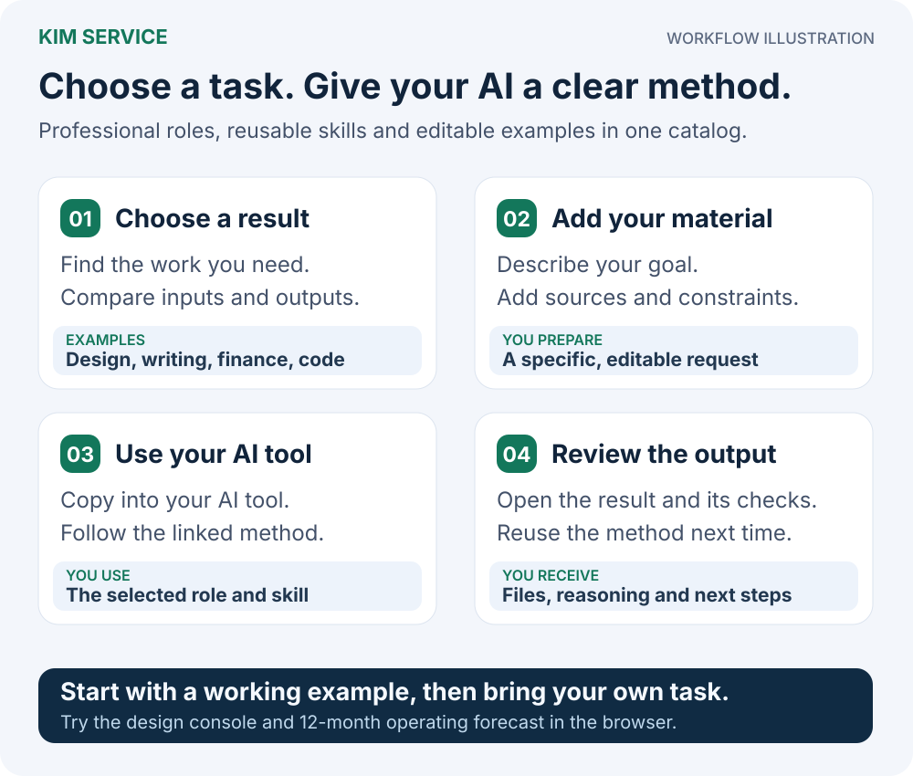

# Kim Service

<p align="center">
  <a href="README.md">简体中文</a> · <a href="README_EN.md">English</a>
</p>

**给 AI Agent 配上做事的方法、专业资料和明确的交付标准。**

Kim Service 是老金（KimYx0207）维护的专业能力库。每个 Agent、Skill、Hook 或 Tool 解决一个明确问题，带有入口、方法、输入输出约定、示例和验证方式。你可以单独使用，也可以由 [Meta_Kim](https://github.com/KimYx0207/Meta_Kim) 发现和调用。

## 先从你要做的事开始

> “我有一个报名产品的想法。请先帮我比较系统方案，再细化用户流程、异常状态、前后端接口和验收。沿用当前项目已经合适的技术，不要只列岗位名字。”

打开[中文任务入口](docs/start.html)，按关键词找到能力，查看所需资料与交付内容，然后复制请求。下载完整仓库后，可以直接在浏览器打开 `docs/start.html` 离线浏览；GitHub 文件页显示的是源码。浏览目录本身不会安装或执行任何组件。

| 你要做的事 | 可以先看 |
| --- | --- |
| 从模糊想法走到系统方案和模块 PRD | [产品架构](agents/product-architect/) |
| 把用户动机变成流程、界面状态与恢复路径 | [交互设计](agents/interaction-designer/) |
| 把设计落实到当前前端技术和可用界面 | [前端工程](agents/frontend-engineer/) |
| 定义数据、接口、事务、权限和迁移行为 | [后端与数据工程](agents/backend-data-engineer/) |
| 核对交付物和实际检查证据 | [交付验证](agents/delivery-verifier/) |
| 内容、教学、运营、分析等其他任务 | [完整专业角色目录](agents/README.md) |

## 一个专业包里有什么？

| 文件 | 用途 |
| --- | --- |
| `AGENT.md` / `SKILL.md` / `README.md` | 入口、适用任务、执行方法与边界 |
| `capability.json` | 可发现的能力、输入、输出、权限和副作用约定 |
| `method.json`（按包提供） | 领域步骤、工具需求、交接方式、质量标准 |
| `references/`（按需） | 实际专业资料；由 `knowledgeAssets` 声明适用范围和来源 |
| `example.json` | 完整示例；明确区分示例数据和真实回执 |
| `tests/`、`scripts/`（按包提供） | 组件检查或范围明确的确定性工具 |
| `PROVENANCE.md`、`LICENSE` | 资料来源、改造边界与许可证 |

新增的产品、交互、前端、后端资料围绕架构取舍、模块接口、交互状态、可访问性、数据不变量、并发和迁移组织。选中的资料会随 Meta_Kim 工单进入实际执行上下文，并校验来源文件的字节。通过文件或合同校验，只说明结构正确；专业成果仍需要当前任务中的审查和验收。

## 与 Meta_Kim 的关系

<p align="center">
  
</p>

*架构示意图。Meta_Kim 负责决策、编排和连续性，Kim Service 提供专业方法与能力。*

系统和技术栈先形成基线，再细化模块、接口、状态和验收。两层设计属于同一份 PRD。模块对应实际交付任务；能否并行由调用方的依赖、资源和权限决定。Kim Service 不另建调度器、权限系统或最终验收状态。

## 使用与更新

1. 从任务入口或索引选包，阅读其入口和必要资料。
2. 提供当前目标、项目事实、验收条件和相关上游产物。单独使用时，让你的客户端读取选中的组件目录；集成使用时由 Meta_Kim 校验并绑定该来源。
3. 宿主提供真实可用工具及已授权范围。缺少工具时，组件交付可用材料和明确缺口，不宣称已写入、已部署或已通过验收。

当前组件安装源就是 **Kim_Service 内选中的目录**。`catalog.json` 的 `source` / `revision` 记录历史来源，不是要求重新克隆旧独立仓库。已有同类能力先核对来源与版本，复用或升级一个入口。

已发布基线：[V1.10](https://github.com/KimYx0207/Kim_Service/releases/tag/V1.10)。当前 [Unreleased](CHANGELOG.md#unreleased) 更新产品架构与交互设计至 0.3.0、前端与后端数据工程至 0.2.0；尚未作为新 Release 发布。

这些包采用可移植内容与显式合同。**Codex、Claude Code、Cursor、Gemini CLI、ZCode 的安装路径、工具和 Hook 约定由各宿主或 Meta_Kim 适配层处理。** 包被复制或成功安装，不等于原生 Agent 加载、真实模型表现或业务验收通过。ZCode 内容包的既有更新路径见 [Beta 指南](docs/zcode-beta.md)。

## 维护与目录

[Agent](agents/) · [Skill](skills/) · [Hook](hooks/) · [Tool](tools/) · [组件目录](catalog.json) · [自动能力索引](generated/capabilities.json)

修改包内源文件后，用同一套生成器维护目录，不手工维护第二份能力总表：

```bash
node scripts/catalog-automation.mjs build
node scripts/start-page.mjs build
node scripts/check-repository.mjs
node --test scripts/*.test.mjs
```

深入阅读：[任务交付指南](docs/task-agent-delivery.md) · [能力包约定](docs/agent-pack-contract.md) · [参考源盘点](docs/task-agent-reference-audit.md) · [变更记录](CHANGELOG.md)。

## 联系与支持

<p align="center">
  
</p>

<table align="center">
  <tr>
    <th align="center">微信收款码</th>
    <th align="center">支付宝收款码</th>
  </tr>
  <tr>
    <td align="center"></td>
    <td align="center"></td>
  </tr>
</table>

如果这些开源项目帮到了你，欢迎 Star、分享，或者请老金喝杯咖啡。

## 开源说明

仓库级内容采用 [MIT License](LICENSE)。每个能力包的许可证及来源记录独立生效，以包内 `LICENSE`、`PROVENANCE` 或同类文件为准。
