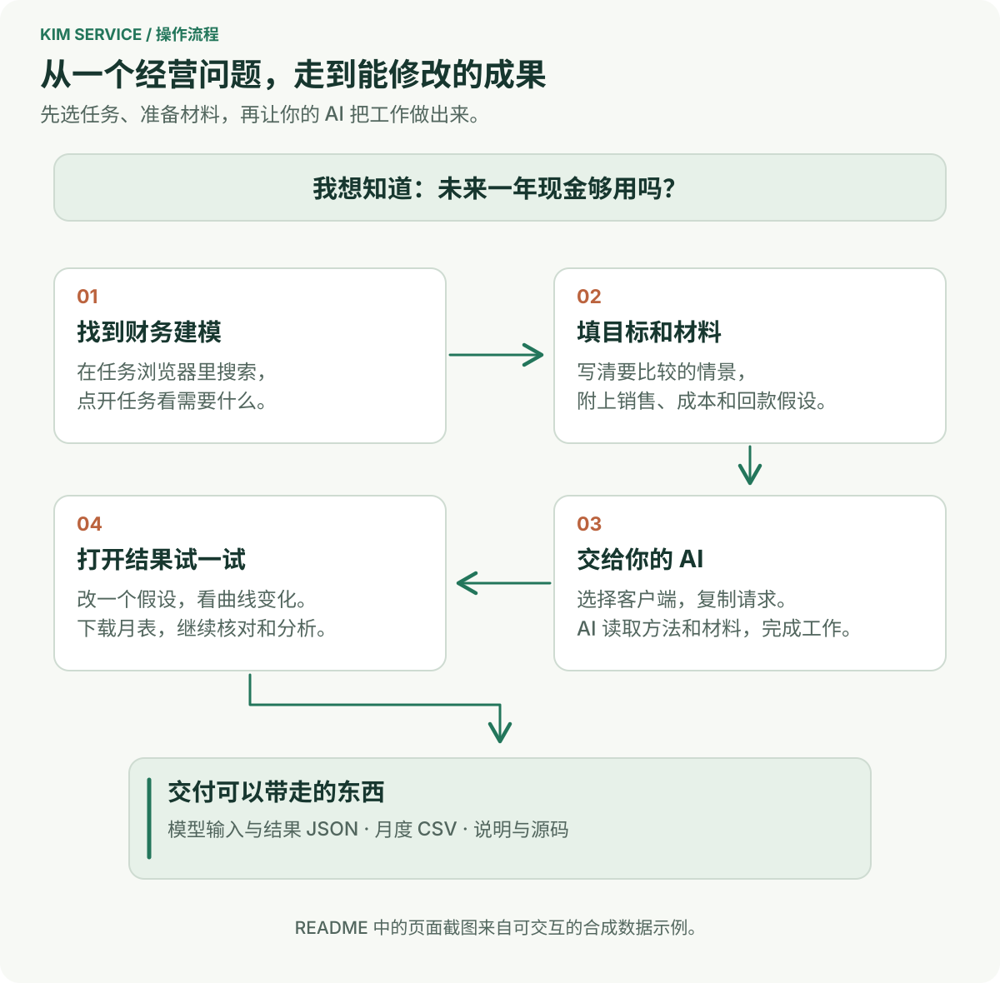
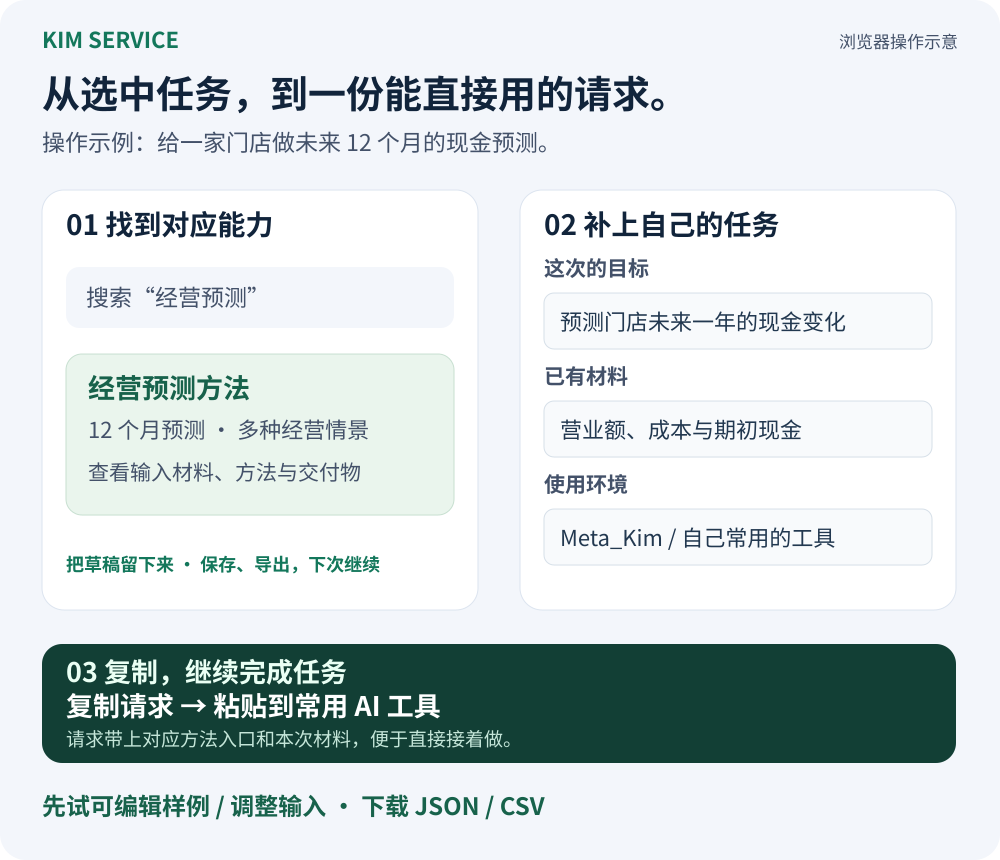

# Kim Service

<p align="center">
  <a href="README.md">简体中文</a> · <a href="README_EN.md">English</a>
</p>

**给 AI 专业方法，把你的需求做成代码、设计、模型和文稿。**

Kim Service 是老金（KimYx0207）维护的专业能力库。每个能力包把一类工作的材料要求、操作方法、参考资料和交付标准放在一起。选好任务，把材料交给你常用的 AI，就能按这套方法继续做；也可以交给 [Meta_Kim](https://github.com/KimYx0207/Meta_Kim) 选择能力、组织协作和检查结果。

**[打开任务浏览器](https://kimyx0207.github.io/Kim_Service/)** · [下载最新版本](https://github.com/KimYx0207/Kim_Service/releases/latest) · [专业角色目录](agents/README.md) · [更新日志](CHANGELOG.zh-CN.md)

<p align="center">
  
</p>

## 从你想拿到的结果开始

| 你要完成的事 | 可以要求交付什么 | 从这里开始 |
| --- | --- | --- |
| 把产品想法变成可开发的方案 | 系统方案、模块需求、用户流程、接口约定和可演示的交付任务 | [产品架构](agents/product-architect/) · [交互设计](agents/interaction-designer/) · [前端实现](agents/frontend-engineer/) |
| 让多个页面保持一致 | 设计变量、组件状态、键盘操作规则、示例页面和迁移方案 | [设计系统](agents/design-system-designer/) |
| 看清未来 12 个月的经营与现金 | 可编辑的假设、利润与现金月表、三种情景及现金缺口说明 | [财务建模](agents/financial-modeler/) |
| 复盘店铺，决定下一步怎么改 | 同口径指标对照、数据问题、变化假设和小范围改进试验 | [店铺分析](agents/store-performance-analyst/) |
| 把选题与资料写成能用的内容 | 完整正文、口播或分镜，开头与结尾方案，以及事实核对 | [脚本与写作](agents/script-writer/) · [标题封面](agents/headline-cover-optimizer/) |

先在能力页看清“需要什么材料”和“会交什么”，再选择适合当前工作的包。代码变更、设计文档、分析模型和内容稿件，都有各自的检查方法。

## 按行业和能力选

当前[组件目录](catalog.json)包含 **71 个组件：48 个专业 Agent、21 个 Skill、1 个 Hook、1 个 Tool**，提供 **[86 项能力入口](generated/capabilities.json)**。Agent 提供某类工作的专业方法，Skill 提供可复用的任务流程；在浏览器里按想做的事搜索即可。

| 工作领域 | 常用能力 |
| --- | --- |
| 软件与 AI | [前端](agents/frontend-engineer/) · [后端与数据](agents/backend-data-engineer/) · [移动应用](agents/mobile-app-engineer/) · [AI 应用](agents/applied-ai-engineer/) · [测试](agents/test-automation-engineer/) |
| 产品与设计 | [需求与架构](agents/product-architect/) · [用户研究](agents/user-researcher/) · [交互](agents/interaction-designer/) · [设计系统](agents/design-system-designer/) · [可访问性](skills/accessibility-audit/) |
| 财务与经营 | [财务建模](agents/financial-modeler/) · [会计对账](agents/accounting-reconciliation-analyst/) · [经营财务](agents/business-finance-analyst/) · [定价成本](agents/pricing-cost-analyst/) |
| 电商与销售 | [店铺复盘](agents/store-performance-analyst/) · [供应商比较](agents/supplier-comparison-analyst/) · [订单运营](agents/commerce-operations-designer/) · [商品文案](agents/product-listing-writer/) · [销售运营](agents/sales-operations-analyst/) |
| 内容与营销 | [选题](agents/topic-planner/) · [脚本](agents/script-writer/) · [标题封面](agents/headline-cover-optimizer/) · [媒体制作](agents/media-production-engineer/) · [小红书](skills/xiaohongshu-skill/) |
| 工作、教育与人才 | [工作沟通](agents/workplace-writer/) · [简历](agents/resume-editor/) · [面试](agents/interview-coach/) · [课程](agents/lesson-planner/) · [学习评价](skills/learning-assessment-design/) |
| 制造、供应链与能源 | [制造质量](agents/manufacturing-quality-analyst/) · [供应链](agents/supply-chain-planner/) · [系统工程](agents/systems-engineering-analyst/) · [能源项目](agents/energy-project-analyst/) · [碳核算](agents/sustainability-analyst/) |
| 更多专业场景 | [医疗运营](agents/healthcare-operations-analyst/) · [农业规划](agents/agronomy-planner/) · [建筑信息](skills/construction-information-review/) · [游戏试玩](skills/game-design-playtest/) |

## 先体验两个可以修改、下载的示例

打开[任务浏览器](https://kimyx0207.github.io/Kim_Service/)，从顶部示例卡进入。两例使用合成数据，适合先体验交付形式，再换成自己的材料。

| 示例 | 可以亲手试什么 | 能带走什么 |
| --- | --- | --- |
| **预约台设计系统** | 切换浅深主题、品牌色、字号和密度；填写预约表单，体验报错、重试与新增记录 | 当前设计变量的 tokens JSON，以及可继续修改的[页面源码](agents/design-system-designer/examples/service-console/) |
| **12 个月经营预测** | 修改销量、价格、成本与回款假设；比较基础、乐观、保守情景，查看利润和现金变化 | 输入 JSON、计算结果 JSON、可在表格软件中打开的月表 CSV，以及[模型源码](agents/financial-modeler/examples/operating-forecast/) |

例如，先打开经营预测，修改一项成本假设，观察现金曲线和月表，再下载 CSV。想把它用于自己的业务，就在财务建模能力页填入目标和真实数据，生成下一步请求。

下载仓库后，也可以直接在浏览器打开 `docs/start.html`，离线浏览能力和两个示例。

## 把选好的任务交给你常用的 AI

### 1. 准备仓库

在 GitHub 点击 **Code → Download ZIP** 并解压，或运行：

```sh
git clone https://github.com/KimYx0207/Kim_Service.git
cd Kim_Service
```

在 AI 客户端中打开这个目录；如果你正在处理另一个项目，把 Kim_Service 的实际目录位置告诉它，确保它能读取能力包和你的任务材料。

### 2. 选择能力，补好目标与材料

在任务浏览器搜索“经营预测”“设计系统”“简历”等关键词，打开能力详情，选择正在使用的客户端，填写目标与材料。客户端未单列时，选择“我正在用的 Agent”。页面会把入口路径、所需输入和交付要求整理成一份可编辑请求。

点击**复制请求**，粘贴到当前 AI 对话中执行。不同能力的请求草稿分开保存；刷新后可接着写，也可以下载、导入草稿。手动补充的要求会保留，重新生成后还能恢复上一版。

<p align="center">
  
</p>

### 3. 先用仓库内示例跑通一次

把下面这段发给已打开 Kim_Service 仓库的 AI：

```text
请读取 agents/financial-modeler/AGENT.md 及其要求的方法资料。

我的目标：做一份未来 12 个月的经营预测示例，理解利润与现金的区别。
材料：使用 agents/financial-modeler/examples/operating-forecast/
中的 sample-data.js，沿用样例的币种、期间和合成经营假设。

请复用包内模型，比较基础、乐观、保守三个情景，
解释主要变化和现金缺口，保留可编辑输入，
交付结果 JSON、月表 CSV，以及一份能看懂的说明。
完成后，按包内标准检查公式、期间与导出文件。
```

换成自己的任务时，替换目标与材料位置，再说明希望得到的文件或结果。拿到交付后，按能力页的标准打开、修改或复算，检查它是否满足你的需求。

## 选择适合你的使用方式

| 使用环境 | 开始方式 |
| --- | --- |
| **Codex、Claude Code、Cursor、Gemini CLI 等可读取项目文件的客户端** | 打开仓库，使用上面的复制请求流程；将常用 Skill 安装到客户端时，按对应包内 README 操作。 |
| **Meta_Kim** | 按 [Meta_Kim 安装说明](https://github.com/KimYx0207/Meta_Kim#readme)接入后，直接描述任务，由它发现和组合需要的专业能力。 |
| **DSH（DeepSeek Harness）** | 按 [DSH 指南](docs/dsh.md)构建完整 Skills 包，通过 Meta_Kim 安装后使用 `/kim-service` 选择能力。 |
| **ZCode** | 按 [ZCode 插件指南](docs/zcode-beta.md)安装完整专业包，在客户端中使用对应角色或 Skill。 |

更新源码使用 `git pull --ff-only`；已经安装到客户端的包，再按相应指南更新。方法、参考资料、示例和许可证应随选中的包一起保留。

## 和 Meta_Kim 一起用

**Kim Service 提供“这项工作怎样做好”；Meta_Kim 负责“整个任务怎样推进”。**

比如做一个预约产品：先用产品架构方法明确方案，再用交互和设计系统方法整理页面行为，由前后端能力落实实现，最后检查实际交付。Meta_Kim 将选定的方法、项目上下文和上一步成果交给执行者，并在后续对话中接续工作。

你也可以单独选用一个包：一次文稿修改、简历优化或财务分析，都可以直接在当前客户端完成。

## 深入使用与参与

一个专业包通常包含入口 `AGENT.md` / `SKILL.md`、输入输出约定、方法步骤、参考资料、案例，以及适用的计算或检查脚本。需要了解某个结果为什么这样做，可以继续读包内方法与出处。

- [任务浏览器使用与维护](docs/task-browser.md)：草稿、页面构建、示例配置与发布。
- [专业能力包作者指南](docs/expert-package-authoring.md)：编写方法、案例和交付检查。
- [组件约定](docs/agent-pack-contract.md)与[仓库维护指南](docs/maintenance.md)：扩展、生成目录和运行检查。
- [行业任务与来源](docs/research/industry-coverage-2026-11-11.md)、[迭代记录](docs/verification/iteration-20261111.md)与[历史验证记录](docs/verification-history.md)：查看方法依据、具体检查与历史结果。
- [Agent](agents/) · [Skill](skills/) · [Hook](hooks/) · [Tool](tools/) · [中文更新日志](CHANGELOG.zh-CN.md)。

## 联系与支持

<p align="center">
  
</p>

<table align="center">
  <tr>
    <th align="center">微信收款码</th>
    <th align="center">支付宝收款码</th>
  </tr>
  <tr>
    <td align="center"></td>
    <td align="center"></td>
  </tr>
</table>

如果这些开源项目帮到了你，欢迎 Star、分享，或者请老金喝杯咖啡。

## 开源说明

仓库级内容采用 [MIT License](LICENSE)。每个能力包保留自己的许可证及来源记录，详见包内 `LICENSE`、`PROVENANCE` 或同类文件。
