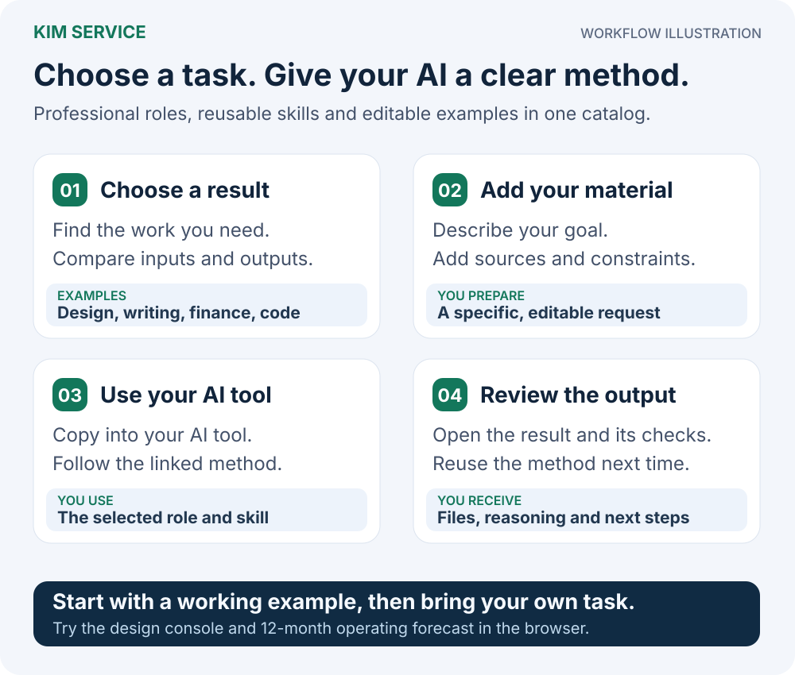
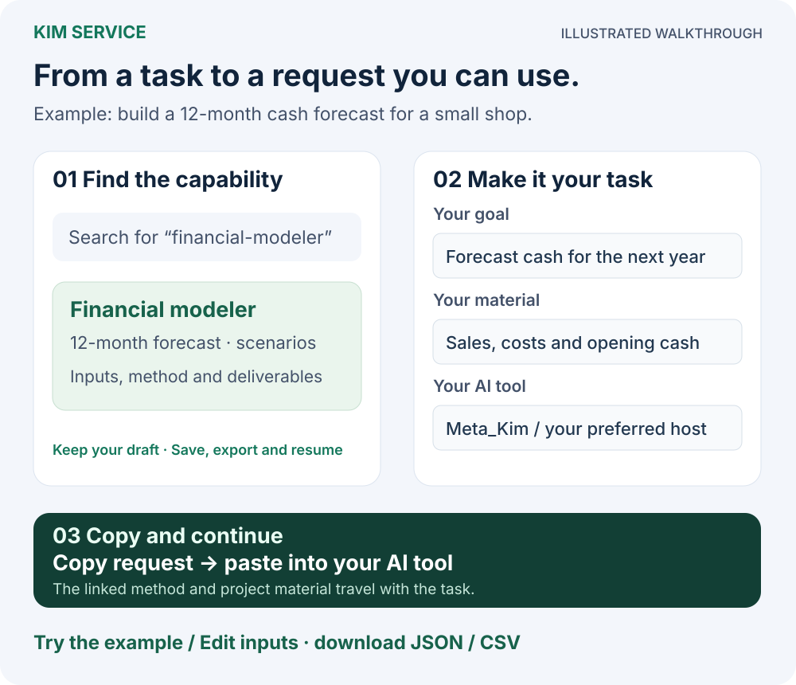

# Kim Service

<p align="center">
  <a href="README.md">简体中文</a> · <a href="README_EN.md">English</a>
</p>

**Give your AI specialist methods for building software, designing interfaces, modeling a business, and writing useful content.**

Kim Service is a professional capability library maintained by Lao Jin (KimYx0207). Each package brings together the inputs, working method, references, and delivery criteria for a particular job. Pick a task and give your usual AI client the materials to work with. You can also use [Meta_Kim](https://github.com/KimYx0207/Meta_Kim) to select capabilities, coordinate the work, and review the result.

**[Open the task browser](https://kimyx0207.github.io/Kim_Service/)** · [Download the latest release](https://github.com/KimYx0207/Kim_Service/releases/latest) · [Browse specialist roles](agents/README.md) · [Changelog](CHANGELOG.md)

<p align="center">
  
</p>

## Start with the result you need

| Your task | What to ask for | Starting point |
| --- | --- | --- |
| Turn a product idea into a buildable plan | System choices, module requirements, user flows, interface contracts, and demonstrable delivery tasks | [Product architecture](agents/product-architect/) · [Interaction design](agents/interaction-designer/) · [Frontend implementation](agents/frontend-engineer/) |
| Make several screens work as one design system | Design tokens, component states, keyboard behavior, example screens, and a migration plan | [Design systems](agents/design-system-designer/) |
| Understand the next 12 months of operations and cash | Editable assumptions, monthly profit and cash tables, three scenarios, and cash shortfall analysis | [Financial modeling](agents/financial-modeler/) |
| Review a store and choose the next improvement | Comparable metrics, data issues, explanations to investigate, and small improvement experiments | [Store performance](agents/store-performance-analyst/) |
| Turn a topic and source material into finished content | An article, spoken script, or storyboard, with openings, endings, and a claims check | [Scripts and writing](agents/script-writer/) · [Headlines and covers](agents/headline-cover-optimizer/) |

Each capability page explains the materials to supply and the expected output. Code, design documents, analytical models, and written content each have their own checks.

## Choose by field or capability

The current [component catalog](catalog.json) contains **71 components: 48 professional Agents, 21 Skills, one Hook, and one Tool**, exposing **[86 capability entries](generated/capabilities.json)**. Agents package specialist methods; Skills package reusable task workflows. Search by the job you want to do.

| Field | Common capabilities |
| --- | --- |
| Software and AI | [Frontend](agents/frontend-engineer/) · [Backend and data](agents/backend-data-engineer/) · [Mobile apps](agents/mobile-app-engineer/) · [Applied AI](agents/applied-ai-engineer/) · [Test automation](agents/test-automation-engineer/) |
| Product and design | [Requirements and architecture](agents/product-architect/) · [User research](agents/user-researcher/) · [Interaction](agents/interaction-designer/) · [Design systems](agents/design-system-designer/) · [Accessibility](skills/accessibility-audit/) |
| Finance and business | [Financial modeling](agents/financial-modeler/) · [Accounting reconciliation](agents/accounting-reconciliation-analyst/) · [Business finance](agents/business-finance-analyst/) · [Pricing and costs](agents/pricing-cost-analyst/) |
| Commerce and sales | [Store analysis](agents/store-performance-analyst/) · [Supplier comparison](agents/supplier-comparison-analyst/) · [Order operations](agents/commerce-operations-designer/) · [Product listings](agents/product-listing-writer/) · [Sales operations](agents/sales-operations-analyst/) |
| Content and marketing | [Topics](agents/topic-planner/) · [Scripts](agents/script-writer/) · [Headlines and covers](agents/headline-cover-optimizer/) · [Media production](agents/media-production-engineer/) · [Xiaohongshu](skills/xiaohongshu-skill/) |
| Work, education, and people | [Workplace writing](agents/workplace-writer/) · [Resumes](agents/resume-editor/) · [Interviews](agents/interview-coach/) · [Lessons](agents/lesson-planner/) · [Learning assessment](skills/learning-assessment-design/) |
| Manufacturing, supply chains, and energy | [Manufacturing quality](agents/manufacturing-quality-analyst/) · [Supply chains](agents/supply-chain-planner/) · [Systems engineering](agents/systems-engineering-analyst/) · [Energy projects](agents/energy-project-analyst/) · [Sustainability](agents/sustainability-analyst/) |
| More professional settings | [Healthcare operations](agents/healthcare-operations-analyst/) · [Agronomy](agents/agronomy-planner/) · [Construction information](skills/construction-information-review/) · [Game playtests](skills/game-design-playtest/) |

## Try two examples you can edit and download

Open the [task browser](https://kimyx0207.github.io/Kim_Service/) and choose an example card at the top. Both examples use synthetic data, so you can explore the output before bringing your own materials. The browser and example interfaces use Chinese; the actions are described below.

| Example | What you can try | What you can take away |
| --- | --- | --- |
| **Booking design system** | Change light/dark theme, brand color, type size, and density; submit the booking form and try validation, retry, and new entries | The current design tokens as JSON, plus editable [page source](agents/design-system-designer/examples/service-console/) |
| **12-month operating forecast** | Change sales, price, cost, and collection assumptions; compare base, upside, and downside scenarios and inspect profit and cash | Input JSON, calculated results as JSON, monthly CSV for a spreadsheet, and the [model source](agents/financial-modeler/examples/operating-forecast/) |

For a quick first run, change a cost assumption in the forecast, inspect the cash chart and monthly table, and download the CSV. To adapt it to your business, select financial modeling in the catalog and enter your goal and actual data.

After downloading the repository, you can also open `docs/start.html` directly in a browser to explore the catalog and both examples offline.

## Hand the task to your usual AI client

### 1. Get the repository

On GitHub, choose **Code → Download ZIP** and extract it, or run:

```sh
git clone https://github.com/KimYx0207/Kim_Service.git
cd Kim_Service
```

Open that directory in your AI client. If you are working in another project, give the client the actual Kim_Service directory location so it can read the package and your task materials.

### 2. Choose a capability and add your materials

Search the task browser for a term such as `financial-modeler`, `design-system-designer`, or `resume`. Open a capability, select your client, and enter your goal and materials. Use the generic current-agent option if your client is not listed. The browser assembles the entry path, required inputs, and expected outputs into an editable request.

Copy the request and paste it into your current AI conversation. Drafts are saved separately for each capability, can resume after a refresh, and can be downloaded or imported. Manual additions stay intact, and you can restore the previous request after regeneration.

<p align="center">
  
</p>

### 3. Run a first task with the included example

Send this to an AI client that has opened the Kim_Service repository:

```text
Read agents/financial-modeler/AGENT.md and its required method materials.

Goal: create a 12-month operating forecast example that explains the
difference between profit and cash.
Materials: use sample-data.js in
agents/financial-modeler/examples/operating-forecast/,
keeping the example's currency, periods, and synthetic assumptions.

Reuse the package's model to compare base, upside, and downside scenarios.
Explain the main changes and cash shortfalls. Keep the inputs editable
and deliver result JSON, a monthly CSV, and a readable explanation.
Check the formulas, periods, and exported files against the package criteria.
```

For your own task, replace the goal and material locations and specify the files or result you need. Open, edit, or recalculate the output using the capability's criteria to decide whether it meets your needs.

## Choose how to use it

| Your environment | How to start |
| --- | --- |
| **Codex, Claude Code, Cursor, Gemini CLI, or another client that can read project files** | Open the repository and use the request workflow above. To install a frequently used Skill, follow that package's README. |
| **Meta_Kim** | Follow the [Meta_Kim installation guide](https://github.com/KimYx0207/Meta_Kim#readme), describe the task, and let it discover and combine the specialist capabilities. |
| **DSH — DeepSeek Harness** | Follow the [DSH guide](docs/dsh.md) to build the complete Skills bundle and install it through Meta_Kim, then use `/kim-service` to choose a capability. |
| **ZCode** | Follow the [ZCode plugin guide](docs/zcode-beta.md) to install the complete professional package and use its roles or Skills in the client. |

Update the source with `git pull --ff-only`, then follow the relevant guide to update packages already installed in a client. Keep the methods, references, examples, and licenses together with the package you select.

## Use it with Meta_Kim

**Kim Service supplies the method for a particular job. Meta_Kim coordinates the overall task.**

For a booking product, that can mean clarifying the system with product architecture, defining screen behavior with interaction and design-system methods, implementing it with frontend and backend capabilities, and reviewing the actual deliverables. Meta_Kim passes the selected methods, project context, and earlier results to the workers and carries the task into later conversations.

You can also use a single package directly in your current client for a writing revision, resume update, or financial analysis.

## Go further and contribute

A professional package typically includes an `AGENT.md` or `SKILL.md` entry, input/output criteria, method steps, references, examples, and applicable calculation or validation scripts. Follow the package's method and source references when you want to understand how a result was produced.

- [Task browser guide](docs/task-browser.md): drafts, page building, example configuration, and publication.
- [Professional package authoring](docs/expert-package-authoring.md): methods, examples, and output checks.
- [Package contract](docs/agent-pack-contract.md) and [repository maintenance](docs/maintenance.md): extending packages, generating the catalog, and running checks.
- [Industry tasks and sources](docs/research/industry-coverage-2026-11-11.md), [iteration record](docs/verification/iteration-20261111.md), and [verification history](docs/verification-history.md): method references, specific checks, and historical results.
- [Agents](agents/) · [Skills](skills/) · [Hooks](hooks/) · [Tools](tools/) · [Changelog](CHANGELOG.md).

## Contact and support

<p align="center">
  
</p>

<table align="center">
  <tr>
    <th align="center">WeChat Pay</th>
    <th align="center">Alipay</th>
  </tr>
  <tr>
    <td align="center"></td>
    <td align="center"></td>
  </tr>
</table>

If these open-source projects help you, please consider starring, sharing, or buying Lao Jin a coffee.

## Open-source note

Repository-level content uses the [MIT License](LICENSE). Each package retains its own license and provenance; see its `LICENSE`, `PROVENANCE`, or equivalent source records.
