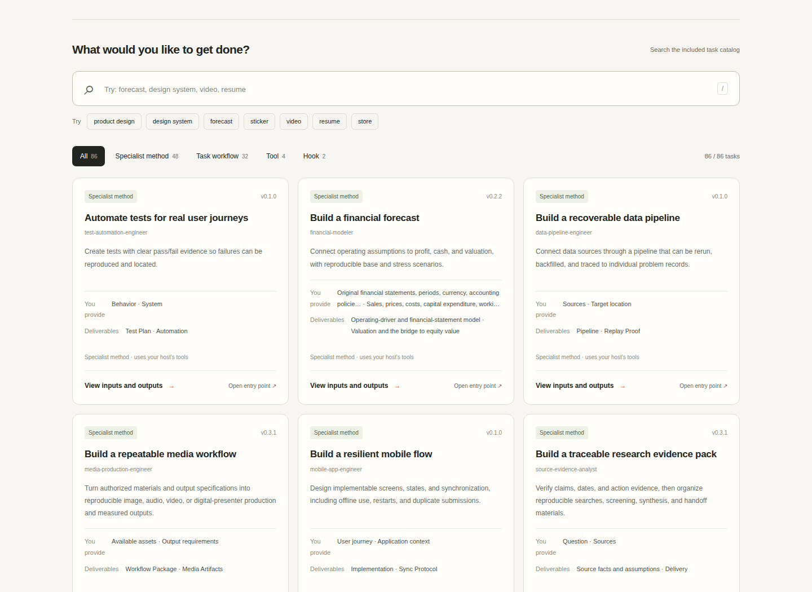
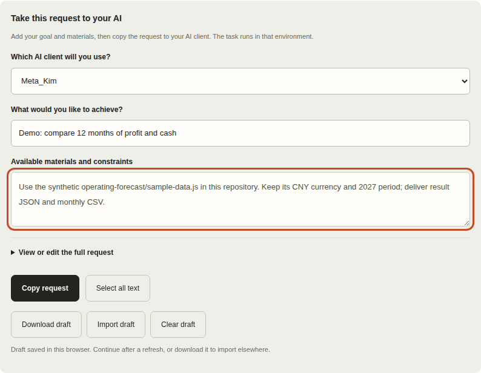
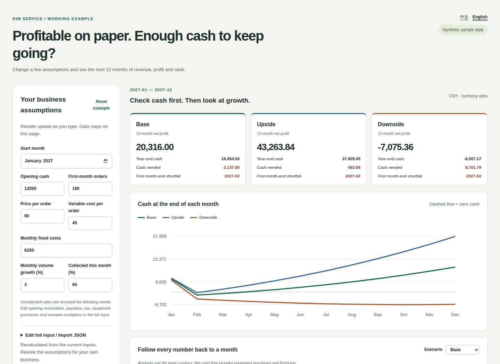
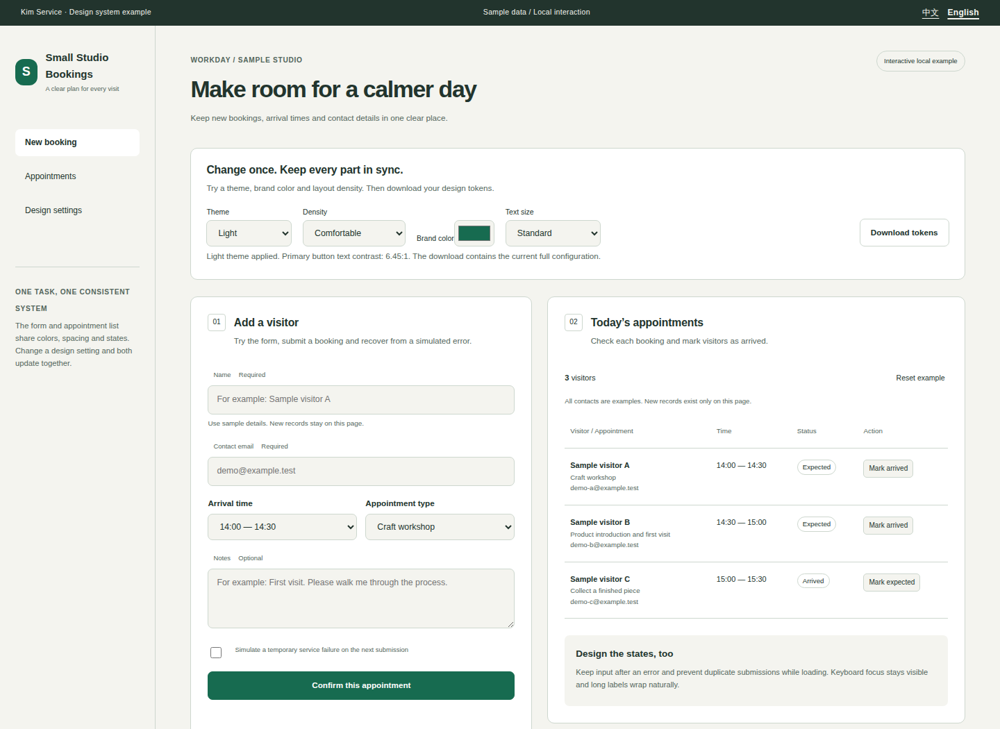
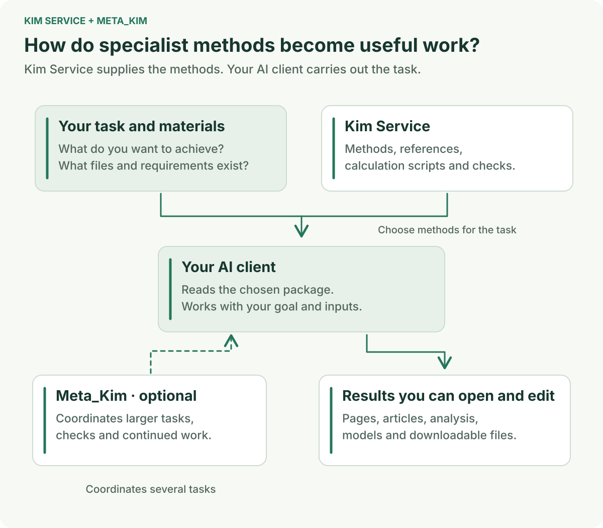

# Kim Service

<p align="center">
  <a href="README.md">简体中文</a> · <a href="README_EN.md">English</a>
</p>

**Give your AI specialist methods for work you can open, edit, and use.**

Build a business forecast, design a set of screens, review a store, or turn source material into an article. Kim Service brings the working methods, references, and checks for these jobs into reusable packages. Choose a task, add your goal and materials, and hand it to the AI you already use.

**[Open the online task browser](https://kimyx0207.github.io/Kim_Service/?lang=en)** · [Try two editable examples](#try-two-editable-examples) · [Download the repository](https://github.com/KimYx0207/Kim_Service/archive/refs/heads/main.zip)

<p align="center">
  
</p>
<p align="center">Start with the job you need done, choose a method, and take the request to your AI client.</p>

## Follow one task from start to finish

> “I want to understand the next 12 months of profit and cash, and see when cash might run short.”

Start with the repository's synthetic business data. You can see what the task needs and explore an operating forecast that you can change and download.

<p align="center">
  
</p>

### 1. Choose a task

Search for “financial-modeler” in the task browser and open [financial modeling](https://kimyx0207.github.io/Kim_Service/?lang=en#capability=financial-modeler-deliver). Check the materials it needs and the outputs it offers, then select your AI client.

### 2. Add your goal and materials

A useful first goal is: “Compare base, upside, and downside scenarios, explain cash shortfalls, and deliver editable inputs, a monthly CSV, and a readable explanation.”

For the first run, point to `agents/financial-modeler/examples/operating-forecast/sample-data.js` in the repository. For your own business, replace it with actual revenue, costs, collection assumptions, and funding plans.

<p align="center">
  
</p>
<p align="center">The browser assembles the entry point, materials, and deliverables. Add your own requirements before copying.</p>

### 3. Copy the request to your AI

[Download the repository](https://github.com/KimYx0207/Kim_Service/archive/refs/heads/main.zip) and open it in your AI client. Copy the request from the task browser and paste it into your current conversation. Your AI can then read the selected methods, references, and calculation scripts to work on the task.

Drafts are saved separately for each task. Continue after a refresh or download a draft to use on another device. If you regenerate a request, you can restore the previous version.

### 4. Open the result and change one assumption

Try changing a price or collection assumption in the forecast below. Watch the cash chart and download the monthly table. When your own task is complete, open, edit, or recalculate the delivered files in the same way to check that they answer your original question.

## Try two editable examples

Both examples use synthetic data. Open them in a browser, or download their source and keep building.

### Operating forecast: growing profit, enough cash?

Bring sales, prices, costs, and collection assumptions into one model. Compare three scenarios and follow the cash balance month by month. Change an input to see its effect, then download a table you can use in a spreadsheet.

<p align="center">
  
</p>

**[Open the operating forecast](https://kimyx0207.github.io/Kim_Service/agents/financial-modeler/examples/operating-forecast/index.html?lang=en)** · [Explore the model source](agents/financial-modeler/examples/operating-forecast/)

Take away: input and result JSON, a monthly CSV, and the model source to adapt.

### Booking console: change the design across the whole page

Switch theme, brand color, type size, and density to see the form, buttons, and booking list change together. Fill in a booking to try validation, recovery after a failed submission, and new records.

<p align="center">
  
</p>

**[Open the booking console](https://kimyx0207.github.io/Kim_Service/agents/design-system-designer/examples/service-console/index.html?lang=en)** · [Explore the page source](agents/design-system-designer/examples/service-console/)

Take away: the current design tokens as JSON and page code you can develop further.

## Start with a task you recognize

- **Build products and software:** turn an idea into a workable plan, then implement screens, APIs, and tests. Start with [product architecture](agents/product-architect/) or [frontend implementation](agents/frontend-engineer/).
- **Understand business and finance:** forecast cash, reconcile accounts, and analyze costs before making the next decision. Explore [financial modeling](agents/financial-modeler/) and [pricing and cost analysis](agents/pricing-cost-analyst/).
- **Run a store or sales operation:** investigate performance changes, improve product copy, and compare suppliers. Explore [store analysis](agents/store-performance-analyst/) and [product listings](agents/product-listing-writer/).
- **Create content and marketing:** turn a topic and sources into articles, spoken scripts, storyboards, and covers. Explore [scripts and writing](agents/script-writer/) and [headlines and covers](agents/headline-cover-optimizer/).
- **Handle work and teaching:** improve a resume, prepare for an interview, write workplace messages, or plan a course. Explore [resume editing](agents/resume-editor/) and [lesson planning](agents/lesson-planner/).
- **Move a specialist project forward:** organize supply-chain plans, manufacturing quality work, or energy-project materials. Find more in the [complete role directory](agents/README.md).

For another task, search the [task browser](https://kimyx0207.github.io/Kim_Service/?lang=en#catalog). The full Agent, Skill, Hook, and tool indexes are linked below.

## Connect it to the AI you already use

Codex, Claude Code, Cursor, Gemini CLI, and other clients that can read project files can open the repository and use these requests. If you prefer the command line:

```sh
git clone https://github.com/KimYx0207/Kim_Service.git
cd Kim_Service
```

If your AI is already working in another project, give it the actual Kim_Service directory location so it can find the methods and your materials. After downloading, you can also open `docs/start.html` directly to browse the catalog and examples offline.

Follow each package's README to install or update packages you use regularly. DSH users can follow the [DSH guide](docs/dsh.md); ZCode users can follow the [ZCode plugin guide](docs/zcode-beta.md). Update the source with `git pull --ff-only`.

## Combine it with Meta_Kim for a larger task

**Kim Service supplies specialist methods. [Meta_Kim](https://github.com/KimYx0207/Meta_Kim) coordinates how those methods fit into the overall task.**

<p align="center">
  
</p>

Turning the booking console into a product involves agreeing on a plan, designing screens, building features, and checking the result. Meta_Kim can connect those steps and carry the project context and earlier outputs into the next one. Kim Service supplies the methods and references for each job.

For a resume edit, an article, or a single analysis, you can also use a package directly. [Get started with Meta_Kim](https://github.com/KimYx0207/Meta_Kim#readme).

## Full directory and further reading

- Find a method: [role directory](agents/README.md) · [all Agents](agents/) · [Skills](skills/) · [Hooks](hooks/) · [tools](tools/).
- Learn more: [task browser guide](docs/task-browser.md) · [package authoring](docs/expert-package-authoring.md) · [package contracts](docs/agent-pack-contract.md).
- Explore sources and maintenance: [industry tasks and sources](docs/research/industry-coverage-2026-11-11.md) · [repository maintenance](docs/maintenance.md) · [verification history](docs/verification-history.md) · [changelog](CHANGELOG.md).

Each package keeps its methods, references, examples, and checks together. Follow those sources when you want to understand how a result was produced.

## Contact and support

<p align="center">
  
</p>

<table align="center">
  <tr>
    <th align="center">WeChat Pay</th>
    <th align="center">Alipay</th>
  </tr>
  <tr>
    <td align="center"></td>
    <td align="center"></td>
  </tr>
</table>

If these open-source projects help you, please consider starring, sharing, or buying Lao Jin a coffee.

## Open source

Repository-level content uses the [MIT License](LICENSE). Each package retains its own license and provenance; see its `LICENSE`, `PROVENANCE`, or equivalent source records.
