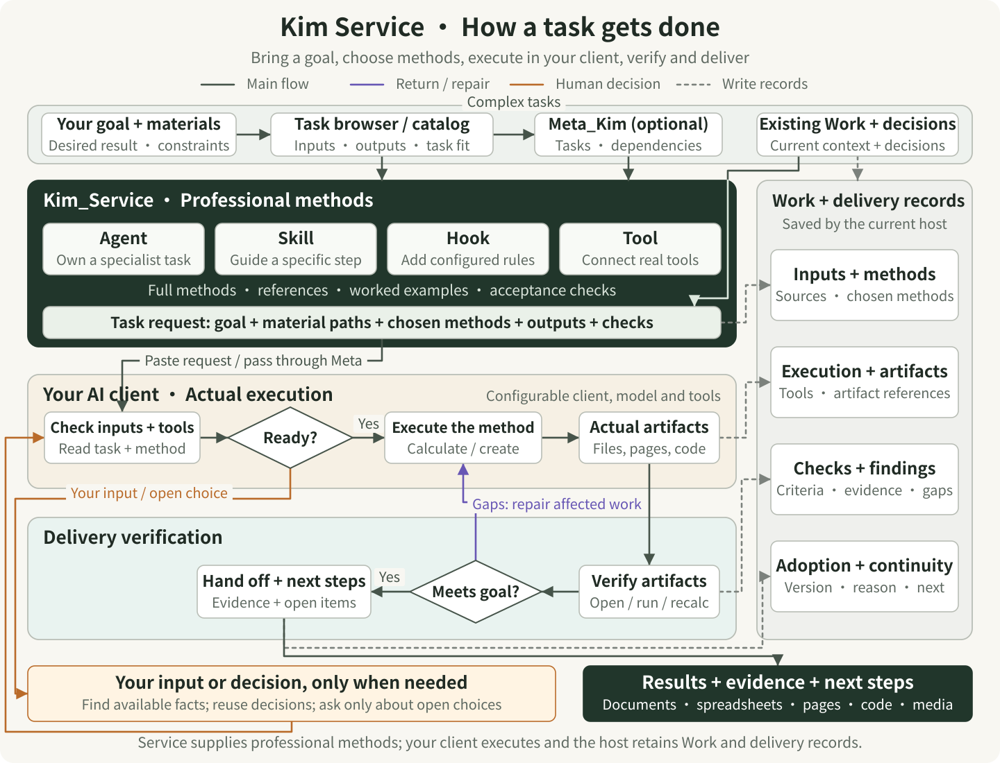
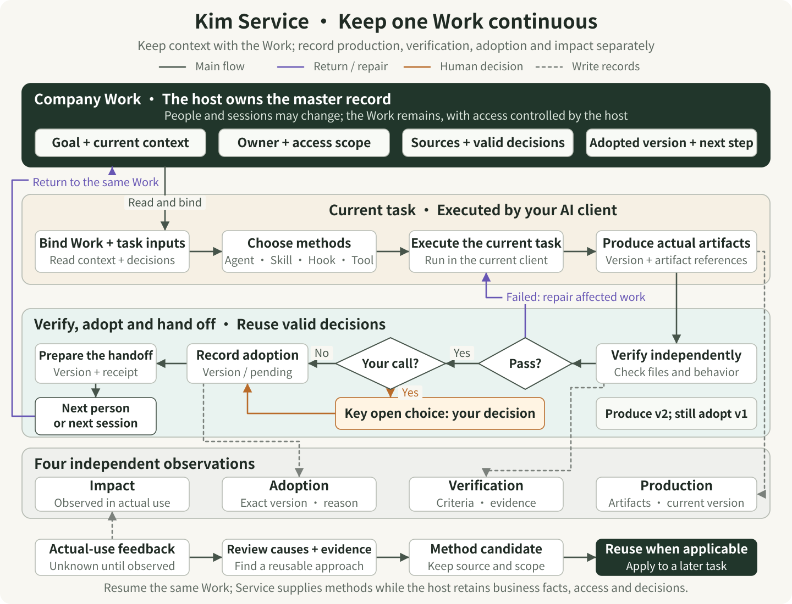
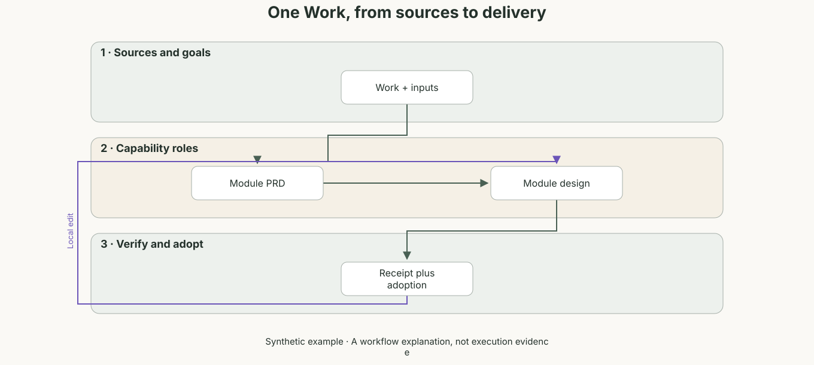

# Kim Service

<p align="center">
  <a href="README.md">简体中文</a> · <a href="README_EN.md">English</a>
</p>

**Give your AI the methods for a professional task. Get results you can open, change, and check.**

Kim Service is an open-source **library of professional methods for AI work**. You supply a business goal and source materials. It supplies role instructions, references, examples, calculation scripts, and acceptance criteria for your existing AI client, turning “help me analyze this” into files you can open, edit, and check.

You may know what you want without knowing which numbers a forecast must reconcile, which states a booking page needs, or how to compare supplier quotes. The methods make the work concrete: inspect materials and evidence, analyze or build the result, then check the actual delivery.

The current release, **V1.16**, includes **58 specialist Agents, 30 Skills, 2 Hooks, and 2 Tools**: 92 components with **107 searchable task capabilities**. Choose one for the job in front of you, or combine several methods within a project.

**[Browse capabilities and prepare a request](https://kimyx0207.github.io/Kim_Service/?lang=en)** · **[Download V1.16 source and packages](https://github.com/KimYx0207/Kim_Service/releases/tag/V1.16)**

Browse **11 industries and 8 shared professional domains → role/job**, or search for the result you need: “cash forecast,” “supplier comparison,” or “booking page.” Check the inputs and deliverables before choosing a method. An Agent here is first a complete professional method package read and executed by the current client; native Agent registration depends on the integration.

## Run one task: goal, materials, method, delivery

1. **Get the source.** Download and extract the V1.16 source from the release above, or run the two commands below.
2. **Make the files accessible to your AI.** Open `Kim_Service` in a project client such as Codex, Claude Code, Cursor, or Gemini CLI. If your work lives elsewhere, provide the full paths to both the method library and the task materials.
3. **Choose a task.** Open the catalog above or local `docs/start.html` in a browser. Search for the goal, check “You provide” and “You receive,” identify your materials, and copy the complete request into the AI client. The web page prepares the request.
4. **Open the delivery before calling it done.** Ask for file paths, checks actually performed, and unfinished items. Repair the affected step when a check fails, keeping the previous version.

```sh
git clone https://github.com/KimYx0207/Kim_Service.git
cd Kim_Service
```

To try the included synthetic financial forecast immediately, paste this complete request into an AI client with the repository open:

```text
Read agents/financial-modeler/AGENT.md, agents/financial-modeler/method.json, and their relevant operating-forecast references.
Use the synthetic input in agents/financial-modeler/examples/operating-forecast/sample-data.js.
Build a 12-month operating forecast with base, optimistic, and conservative scenarios. Explain months where profit grows but cash is insufficient.
Actually run the available calculations. Save editable inputs, result JSON, monthly CSV, and an explanation to deliveries/forecast/ in the current project.
Check periods, currency, units, and cash reconciliation. List actual output paths, check results, assumptions, and unfinished items.
```

**Input → output:** business goal + readable materials + selected method → editable artifacts + calculation or operation evidence + checks + next step. The complete workflow follows below; choose your client integration afterward. A first task can read the method directly.

<p align="center">
  
</p>

Start with the goal and materials at the top, then follow the dark arrows through method selection, the complete request, client execution and delivery checks. Meta_Kim is optional for complex work. Purple paths return issues to the affected task; orange paths request human input only when needed; dashed gray paths lead to records owned by the host. The client, model and tools are configured separately. Service supplies methods, references, examples and check criteria.

## How it helps you do the work thoroughly

Professional work often gets stuck between the request and the result: inconsistent source data, a conclusion without evidence, a form that only handles valid input, or files that someone else cannot open. Kim Service puts these easily missed steps into each method package, taking the work from checking materials to checking the handoff.

Financial modeling starts with periods, currency, and units, then connects sales volume, prices, costs, and collections to profit and cash. Design-system work organizes colors and typography into reusable design values while addressing focus, errors, loading, long text, and theme changes. Each package also explains when a result needs rework, what evidence to inspect, and which useful parts can proceed when some materials are missing.

### What the four kinds of component do

- **Agents handle a complete professional task.** Each of the 58 roles has a defined scope, inputs and outputs, reference material, decision steps, positive and negative examples, and quality checks. Financial modeling receives business data; design-system work receives screens, brand choices, and interaction requirements. Their methods lead to different, concrete deliverables.
- **Skills support a particular step.** The 30 reusable skills cover requirements tracing, API contracts, database migration, accessibility, financial scenarios, experiments, retrieval evaluation, and learning assessment. They also include workflows for teamwork, memory, skill discovery, Xiaohongshu, and sticker production. Select the ones the current job needs.
- **Hooks clarify requests and record delivered versions.** In a supported, configured client, HookPrompt adds context about the goal, scope, output, and checks to substantive task prompts. It preserves decisions already made in the conversation. The opt-in evidence Hook records hashes of explicitly selected local artifacts.
- **Tools connect and inspect execution capabilities.** The multi-CLI package can expose locally installed Codex and Gemini through MCP to a compatible client for coding or review, with project-level workflow entries. The offline MCP auditor examines tool-definition changes. The current client still controls the working directory and permitted file operations.

Together, the specialist Agent supplies the professional method, Skills support particular steps, the Hook helps express the request, and tools perform the operations. Load the parts relevant to the task. Instructions, references, examples, and check scripts stay with the source, so a result can be traced to the materials and checks behind it.

<p align="center">
  
</p>

**Start with the deliverable, then choose the combination this task needs.** For one operating forecast, ask the AI to read the financial-modeling method directly. Add the relevant Skill when you need more detailed stress scenarios. The Hook helps with recurring request preparation; the Tool connects available execution tools. Choose what to install and load based on the task and client. You can start with just the method you need.

## Example: build a product-information assistant for a sales team

A customer says, “Sales staff take too long to find product information; we want an AI assistant.” Bring actual questions, product documents, the current workflow, and access requirements. The methods below can handle the relevant parts of the work.

First determine whether the difficulty comes from retrieval, missing information, or the process itself. Check primary sources and compare options. Once a retrieval assistant is selected, design citations, updates, and failure handling; implement a demonstrable slice; check it with real questions; then turn usage observations into further requirements. The delivery can include a requirements-and-evidence table, a design, a working assistant, evaluation records, and maintenance instructions.

| Current work | Existing methods to reuse | Concrete handoff |
| --- | --- | --- |
| Understand the business and break down the problem | `agents/user-researcher/`, `skills/feedback-to-requirements/` | Behavioral evidence, sources and disagreements, requirement candidates, questions to test |
| Search, verify, and research | `agents/source-evidence-analyst/`, `skills/evidence-pack/` | Dated, sourced facts, conflicting evidence, complete source pack, and gaps |
| Develop options and make tradeoffs | `agents/product-architect/` | Scope, alternatives and recommendation evidence, system/module design, demonstrable slices |
| Build and integrate | `agents/applied-ai-engineer/`, `agents/data-pipeline-engineer/`, with frontend/backend roles as needed | Actual AI features, data processing and interfaces, evaluation or execution records |
| Verify, recover, and hand over | `agents/reliability-engineer/`, `agents/delivery-verifier/` | Reliability/recovery plans, actual file checks, unverified criteria, next steps |
| Follow usage and new feedback | `skills/customer-case-operations/`, `skills/feedback-to-requirements/` | Case phases, receipt/adoption records, open feedback, requirement candidates |

Read an Agent's `AGENT.md` or a Skill's `SKILL.md`, then follow its references. Select the methods needed for the task and pass each result to the next step. Finally, check whether the assistant answers actual questions, cites its sources, and handles questions it cannot answer.

### Full-corpus practice: an enterprise technical-support knowledge workbench

`examples/enterprise-knowledge/` contains a runnable case: import a fixed public IBM Cloud historical corpus, audit documents and passages, build lexical and vector indexes, and compare BM25, dense retrieval, RRF fusion and reranking on the same 188 public benchmark questions. Open source passages, inspect citations and failed queries, and exercise permission withdrawal, deletion, index rollback and interrupted-job recovery. The pinned archives contain 8,578 document records and 72,442 passages; every run audits its own inputs.

This example is provided in the **main branch source**. Get the current source with the `git clone` command above; use the V1.16 assets for component installation and the main checkout for this example. On Linux or WSL with Python 3.12 installed, run from the repository root:

```bash
cd examples/enterprise-knowledge
python -m venv .venv
source .venv/bin/activate
python -m pip install -r requirements.txt
python scripts/ingest.py
python scripts/audit_documents.py
python scripts/download_models.py
python scripts/build_index.py --generation cloud-minilm-v2 --threads 3 --activate
python -m app.main --port 4180
```

Open `http://127.0.0.1:4180`, enter a technical question and switch retrieval methods. The example README includes full evaluation, int8 storage comparison and actual browser-capture commands; CI retains per-query reports and screenshots. This evaluates retrieval and engineering behavior on public materials. Business outcomes still need an organization's own documents, permissions and user questions.

<a id="capability-directory"></a>

## Work you can start here

**For a product, website, or application,** start with user research and the smallest useful scope, then move into interaction, brand and design systems, frontend and backend work, mobile apps, applied AI, or data pipelines. Existing products can use the same entry point for test automation, security review, and reliability improvements. Outputs include plans, interfaces, code, screens, and check records that another person can continue from.

**For a store, sales operation, or new business,** bring SKU sales, customer questions, supplier quotes, stock, and cost data. Establish a comparable basis, explain changes, then prepare product copy, customer replies, purchasing comparisons, replenishment plans, sales forecasts, or pricing calculations. A supplier comparison, for example, accounts for minimum quantities, landed costs, and delivery evidence, and shows how missing terms affect the choice.

**For business finance and investment research,** reconcile records, explain budget differences, forecast cash, model project value and stress scenarios, organize research, or examine assumptions in a quantitative backtest. Deliverables include calculations tied to inputs, scenario comparisons, critical assumptions, and unresolved questions for the responsible decision-maker. The forecast below is a complete starting point.

**For content, marketing, and everyday collaboration,** move from an audience and topic into articles, narration, storyboards, headlines, covers, and media production, or turn scattered progress into emails, reports, and operating procedures. Career, hiring, and teaching tasks also have methods: role-specific resumes and interview practice, structured hiring criteria, lesson plans, explanations, exercises, and learning assessment all lead to defined, usable outputs.

**For physical operations and engineering projects,** work through manufacturing quality, system requirements and interfaces, construction information, energy projects, emissions accounting, field-water planning, or nonclinical healthcare service processes. The methods make scope, sources, units, exceptions, and on-site checks explicit, producing analysis, verification plans, or pilot proposals while retaining the items that need local evidence and professional judgment.

The 107 capabilities describe the available task entries. Start with the result you need, search for it in the browser, and check the required materials. You do not need to memorize role names.

<a id="task-browser"></a>

### Business inputs and deliverables

These methods address specific business decisions. Each Agent includes material requirements, diagnostic branches, a complete delivery template, acceptable and rejected examples, and evidence-based output checks. Entrypoints stay compact; detailed references are loaded when needed.

| Search the catalog for | Bring | Expected deliverable |
| --- | --- | --- |
| Credit risk | Loan exposure, repayment and arrears records, sourced assumptions | Risk breakdown, expected-loss scenarios and evidence gaps |
| Treasury liquidity | Available cash, payment timing and financing constraints | Maturity-bucket cash gaps, stress scenarios and funding options |
| Insurance claims | Policy version, loss evidence, deductibles and limits | Evidence mapping, conditional payout calculations and disputed items |
| Contract review | Complete clauses, attachments, transaction goals and scope | Obligations, evidence-backed risks and proposed amendments |
| Maintenance reliability | Asset registers, failures, downtime and repair records | Reliability measures, fault diagnosis and maintenance options |
| Warehouse operations | Inventory, reservations, movements, locations and constraints | Available-to-promise reconciliation, bottlenecks and improvements |
| Construction project control | Work breakdown, baseline, progress, costs and changes | Schedule/cost variance, change impact and recovery options |
| Hospitality revenue | Room capacity, rates, cancellations, channel fees and demand | Net revenue comparisons, inventory/rate options and sensitivities |
| Game economy | Currency sources and sinks, rewards, items and player segments | Currency balance, inflation risks and testable economy changes |
| Security incidents | Authorized alerts, logs, timelines and affected assets | Evidence timeline, incident scope, response and recovery options |

Search for the business task, review its inputs and deliverables, then copy the request into a client that can read the repository and your materials. Complete supported parts first and list any evidence gaps that affect the conclusion in the delivery.

### Add support for a particular step

| Capability | Practical use |
| --- | --- |
| Data lineage and change impact | Trace affected tables, fields and jobs through supplied dependencies, retaining impact paths |
| Inventory replenishment | Recompute replenishment options from demand, lead times, service targets and pack constraints |
| Incident postmortem | Check event timing, impact and follow-up actions, including owners and verification methods |
| Tender compliance | Map requirements to responses, evidence and gaps, distinguishing mandatory conditions |
| MCP contract audit | Compare tool lists, input/output definitions and risk hints in an offline report |
| Local evidence receipt Hook | Hash explicitly selected files so handoffs can identify the delivered version |

The four Skills and MCP auditor include executable synthetic examples and local scripts, using the machine interface below. MCP auditing runs offline; the local evidence-receipt Hook requires explicit opt-in and records the files you select.

## From your first visit to a completed task

After getting the source as described above, follow these two complete examples from request to delivery. Keep task materials where the current client can read them. For a chat interface that only accepts uploads, attach the selected method entrypoint, its referenced resources, and your task files. The interactive examples' local `index.html` files open directly in a browser; calculation or development scripts require their corresponding Node.js, Python, and client tools.

### Example one: will growing profit leave enough cash next year?

Start with the synthetic data, then replace it with your own business inputs. This example connects task selection, materials, execution, delivery checks, and the next revision.

<p align="center">
  
</p>

**Step 1: turn a question into a task choice.** Start with “Profit appears to be growing next year. Will we have enough cash?” Search the task browser for “financial-modeler” and open financial modeling. The browser searches task descriptions, inputs, outputs, and existing aliases. Compare each card's required inputs and promised outputs to see whether it fits your question.

<p align="center">
  
</p>

**Step 2: inspect the example and check your materials.** Task details list the required inputs, outputs, method entry point, and examples. For the first attempt, use `agents/financial-modeler/examples/operating-forecast/sample-data.js`. It declares sales volume, prices, costs, opening balances, collection assumptions, and equipment spending. Amounts are in CNY, and all data is synthetic. For your business, replace it with actual statements and assumptions, stating the periods, currency, and missing items. The materials field describes where files are; give the AI actual access to those files too.

**Step 3: choose the method and give the request to your AI.** Select your current AI client. Set the goal to “Compare base, upside, and downside scenarios for the next 12 months, identify cash-pressure months, and deliver editable inputs, a monthly table, and an explanation.” Add the material locations. The page assembles the entry point, inputs, and output requirements into an editable request. Review it, copy it, and paste it into the client where you opened the repository. Direct reading works for a single task. For repeated use, install the entry through DSH, ZCode, or the supported mechanism described below for your client.

<p align="center">
  
</p>

**Step 4: let the AI follow the method and run the calculations.** It now reads the materials, aligns the data, connects income and cash, and compares scenarios. You can append this to the complete request to make execution and outputs explicit:

```text
Read agents/financial-modeler/AGENT.md, its referenced method.json, and the materials needed for this task.
Use the synthetic data in agents/financial-modeler/examples/operating-forecast/sample-data.js for a 12-month operating forecast.
Check periods, currency, and units. Explain the difference between profit and cash, and compare base, upside, and downside scenarios.
Run the calculations available in this environment. Deliver editable inputs, result JSON, monthly CSV, and an explanation.
List the check results, where each file can be opened, and unfinished items. Record missing data as explicit assumptions.
```

**Step 5: open the result and check it yourself.** The interactive example below is supplied with the repository to demonstrate this kind of deliverable. Open it online, or open `agents/financial-modeler/examples/operating-forecast/index.html` locally. Change a price, sales volume, or collection assumption; inspect the scenarios and monthly cash curve; then download the inputs, result JSON, and monthly CSV.

<p align="center">
  
</p>

**[Try the operating forecast](https://kimyx0207.github.io/Kim_Service/agents/financial-modeler/examples/operating-forecast/index.html?lang=en)**

For an actual delivery, first reconcile the inputs with the source materials. Spot-check one month's opening cash plus receipts minus payments against closing cash, including equipment spending and collection timing. Check which assumptions differ across scenarios. Open the JSON, CSV, and notes from the delivery folder so another person can use them. This example covers operating profit and cash; valuation or a complete three-statement model needs additional work for that task.

When a check fails, identify the affected step. Fix a path or format when a file cannot open; revisit inputs and formulas when cash does not reconcile; list the relevant assumptions when data is missing. Ask the AI to repair the affected result and repeat the same check. Work supported by sufficient evidence can continue.

**Step 6: retain the result and continue the iteration.** Keep inputs, outputs, explanations, and check records in this project's delivery folder. Record agreed assumptions, unresolved items, and the next step. You can then say: “Keep the other assumptions. Change same-month collection from 65% to 45%, recalculate all three scenarios, explain which months change, and preserve the previous version.” The loop in the diagram represents this revision: change an input, return to calculation, and verify the affected results. Later work uses the same method and actual files.

### Example two: make a booking page consistent and ready for further development

Describe the task: “Unify this booking console's buttons, form, and list. Support light and dark themes and larger text, handle errors and recovery, preserve the existing fields, and pilot the changes on this page.”

Give the AI the current screen, brand colors, real copy, target devices, and technical constraints. For a first attempt, use the sample under `agents/design-system-designer/examples/service-console/`. Ask it to read the design-system role's `AGENT.md` and referenced methods, organize shared color, typography, and spacing rules, define component states, then implement and check them in this page.

<p align="center">
  
</p>

**[Try the booking console](https://kimyx0207.github.io/Kim_Service/agents/design-system-designer/examples/service-console/index.html?lang=en)**

You can also open `agents/design-system-designer/examples/service-console/index.html` locally. Change the theme, brand color, text size, and density to see the page respond together. Leave a field empty, enter an invalid value, and try a simulated submission failure and recovery. The sample records are synthetic, so you can repeat the exercise.

The expected delivery is editable page source, exportable design values in JSON, descriptions of normal and error states, and a migration plan for the existing page. Walk through the form with the keyboard; check whether errors are clear, failed submissions retain input, and long text works at phone width. Also check language and theme switching. A later request can focus on “the compact layout feels cramped on a phone,” carrying forward the agreed rules.

### Continue when the request is only half written

Each task keeps its own draft. Resume after a refresh; before changing devices, download the draft and import it into the same task elsewhere. Form changes preserve a manually edited request. Choose “Regenerate from the form” when you want to rebuild it, with “Restore previous version” available afterward. If browser storage is unavailable or full, download the draft to preserve the current edit.

When large materials exceed the inline budget, the request uses file references and the page offers downloads of the complete source. Attach those files to your AI conversation or place them in a workspace the Agent can read, then have it retrieve the sections needed for the current module. The page does not upload files. Drafts store materials once and rebuild automatic requests on restore; authored requests and undo versions are preserved. `contentPolicy` in `config/task-browser.json` owns the inline budgets and the shared draft export/import limit: currently 4 KiB for goals, 16 KiB for materials, and 16 MiB for drafts. Above the draft limit, the page keeps current edits and tells you to download the complete materials, save authored request text, and use file references before exporting. It does not produce an export that the same configuration cannot import.

## Use it directly, or let Meta_Kim organize the project

**For one clear task, use Kim Service directly.** Edit a resume, compare quotes, or complete the forecast or design pilot above: choose a method, provide materials, let the current AI client work, and inspect the delivery. The specialist Agent, relevant Skills, and available tools support that task.

**For several connected tasks, combine it with Meta_Kim.** Turning the booking console into a product involves understanding users and scope, agreeing on a design, building frontend and backend behavior, testing the delivery, and continuing in later sessions. Meta_Kim organizes those steps, assigns work that can run in parallel, retains decisions and progress, and reviews handoffs. Kim Service supplies the professional methods and references for each step; the AI client performs the operations.

<p align="center">
  
</p>

**Follow one booking project through the diagram.** Two design passes develop the same PRD. The first defines modules such as booking, time slots, and records, along with their shared contracts. The second details each module's inputs, page states, interfaces, and acceptance checks. Meta discovers available methods during research and selects the combination during design: design-system and frontend methods for the page, backend and data methods for the interface. Execution then passes the selected methods and concrete work to the current client's execution capabilities.

Set shared dependencies first, then run independent work in parallel. If a new booking field needs clarification during implementation, the affected interface waits while styles and unrelated error messages continue. Once the field is defined, resume from completed work. Join the page and interface, complete an actual booking, inspect failure cases, and save the decisions, outputs, and next step. The diagram shows that split, local wait, and rejoin.

Service supplies readable professional methods, input guidance, and check criteria. Meta manages task order, method selection, and handoffs. The client performs actual tool calls and concurrent work. After a search match, the workflow still checks whether the method fits the scope, the inputs are accessible, and the needed tools are available before starting the relevant operations.

**First, tell Meta_Kim which Service source to use.** If Meta_Kim's installer has registered a managed Service source, it can use that installation. When you download the two repositories yourself, bind them explicitly; placing them beside each other does not connect them automatically. In the root of the project you actually work on, create or edit `.meta-kim/local.overrides.json`, keep existing fields, and add:

```json
{
  "dependencyRoots": {
    "kim-service": "/absolute/path/Kim_Service"
  }
}
```

Replace the value with your full Kim_Service path; `C:/work/Kim_Service` works as a Windows-style example. If `dependencyRoots` already exists, add only its `kim-service` entry without overwriting other settings.

Alternatively, set `META_KIM_KIM_SERVICE_ROOT` in the same terminal that launches your AI client: use `export META_KIM_KIM_SERVICE_ROOT="/absolute/path/Kim_Service"` on macOS/Linux, or `$env:META_KIM_KIM_SERVICE_ROOT="C:/work/Kim_Service"` in PowerShell. The environment variable takes precedence over project settings. Fix an invalid path directly; the resolver will not silently switch to another copy.

Then open the client in the project already configured for Meta_Kim, select **Meta_Kim** in the task browser, copy the request prefixed with `/meta-theory`, and identify the task materials. Ask it to confirm the discovered Service path and selected method before starting. Check how the parts connect: does the design meet the requirements, does the implementation follow the design, and do the tests cover the user journey?

Use [Meta_Kim](https://github.com/KimYx0207/Meta_Kim#readme) when you need that overall workflow. The complete methods and examples here also support a single independent task.

## Keep company work continuous across conversations and people

<p align="center">
  
</p>

Begin with the host-owned Work at the top, then follow execution, verification, the adoption record and the handoff back to that same Work. The four observations below are independent: producing v2, passing verification and continuing to adopt v1 can all be true. Unresolved adoption stays pending; impact without real-use evidence stays unknown. Only a necessary open choice takes the orange branch; existing authority and valid decisions remain usable. Feedback is reviewed and checked for applicability before reuse in later work.

A company with one operator still needs a working record that a future colleague can continue. The host attaches the goal, sources, adopted version and decisions to one **Work**, a long-lived business matter. Many conversations and runs can refer to it; Service supplies the professional methods. The host's existing permissions determine access to company assets, personal preferences and sensitive decisions.

<p align="center">
  
</p>

| Existing method | How it supports continuation |
| --- | --- |
| `skills/agent-teams-playbook/` | Optional WorkContext connects assignments, sources and versions; handoffs include scope, adopted output, next action and receiving receipt |
| `skills/sop-runbook/` | Separate production, verification, adoption and effect in existing runbook outputs; human choices name exact versions and reasons or unknown |
| `skills/memory-3layer/` | Retain success, failure, rejection, applicability, expiry and actual reuse feedback as company-internal candidates for review |
| `agents/delivery-verifier/` | Optional work_handoff reads actual files and checks versions/hashes, Work/context/run, adoption observations and receiving consistency |

For example, this run creates course draft v2 and its technical checks pass, while the owner continues using the previously adopted v1. Both versions remain distinct in the handoff. The original valid decision remains referenced without asking the human to approve it again. A sent notice is not a receiving receipt; receiving is not business completion. Without effect evidence, keep unknown. Reasons for rejecting the new draft can also become experience candidates.

Run the complete synthetic local example from the repository root:

```sh
node agents/delivery-verifier/scripts/demo-work-handoff.mjs
```

The example creates temporary files and invokes the read-only verifier to check a normal handoff, failed or rejected observations, stale context, and mismatched adopted versions. See the [delivery API](agents/delivery-verifier/docs/delivery-api.md) for the complete fields.

Standalone tasks retain their existing entry points; add WorkContext when a handoff needs to continue across conversations. Review company experience before reusing it. The actual business host manages Work records, scheduled curation, and messages.

## Connect the methods to your client

**Professional methods do not require one model vendor.** The task and host configuration determine the client, model and available tools separately. Claude Code, Codex, Gemini CLI, ZCode, MiniMax Code and other clients that can read the resources can use the same methods within their actual capabilities. The task browser reads its client list from `config/task-browser.json`; choose the existing-Agent option to keep your current environment.

**Before starting:** the client needs access to the complete method and task materials, plus the tools and authorization the work requires. After importing a method, run an example in that client, open its outputs, and check execution and continuation.

| Item | Configuration and behavior |
| --- | --- |
| Task-browser client options | Generate request text; selecting a name does not launch a client, connect an account or switch a real model |
| Specialist execution and independent review | Use host tools and model settings; responsibilities are not fixed to a branded CLI, and retries depend on progress, evidence and the task budget |
| Team-method installation | Explicit `--target`, then `AGENT_TEAMS_INSTALL_TARGET`; with neither, show usage without writing a default Claude directory |
| Another client’s Skills directory | `--target custom --skills-dir /absolute/host/skills` installs a portable method package only; the host supplies the path and native loading needs verification in that client |
| Memory host and model provenance | `MEMORY_HOST` or payload `runtime / host / client` identifies the host; model is separate, and no host declaration remains `manual` |

For example, Claude Code using a MiniMax model keeps client and model information separately. The host configures accounts, models, and tools; optional multi-CLI tools retain the selected CLI’s model settings when no model is specified.

### Project-based AI clients

With Codex, Claude Code, Cursor, Gemini CLI, and similar clients, open the repository or provide the selected package as described above. Identify the role, the relevant materials, and the output location so the work stays easy to review. Frequently used Skills can also be enabled through the client's supported skill installation mechanism, keeping their full resource directories.

HookPrompt and the multi-CLI tool are optional integrations. When you need them, ask the AI to read `hooks/hookprompt/README.md` or `tools/claudecode-codex-gemini/README.md`, configure the current client, and check actual loading. Your first professional task can use the direct repository-reading workflow above.

<a id="dsh"></a>

### DSH (DeepSeek Harness)

In DSH, specialist Agent methods and Skills are discovered as native Skills, retaining their complete methods, knowledge, examples, scripts, and licenses. The current adapter targets DSH **0.2.2-rc.1** and requires **Node.js 24.9.0+**. Prepare DSH's own model and tool configuration first. If the client is not installed, run:

```sh
npm install --global @deepseek-ai/dsh@0.2.2-rc.1
```

**Prepare the Service package.** Download `Kim_Service-DSH-V1.16.zip` from the release linked above, extract it, and identify the directory containing `dsh-package.json`. Alternatively, build it from the Kim_Service repository. Replace the output below with your own full path; the directory must not exist yet:

```sh
node scripts/build-dsh-package.mjs --output "/absolute/path/kim-service-dsh"
node scripts/build-dsh-package.mjs --output "/absolute/path/kim-service-dsh" --check
```

**Install into DSH and check it.** Meta_Kim's installer manages this integration. If you already have the Meta_Kim source, enter that folder; otherwise, download it first. This example installs at user scope for use across projects:

```sh
git clone https://github.com/KimYx0207/Meta_Kim.git
cd Meta_Kim
npm install
node bin/meta-kim.mjs dsh install --service-package "/absolute/path/kim-service-dsh"
node bin/meta-kim.mjs dsh check
dsh --profile meta-kim
```

In the DSH session, enter `/kim-service` to inspect the loaded directory, then choose an entry such as `/kim-financial-modeler`. Confirm that it can read the full method before providing the task materials. Long resources are read through their bundled part indexes; calculations execute the complete original scripts.

**For one project only,** prepare the Meta_Kim source, then run this project-scoped installation and check from its directory:

```sh
node bin/meta-kim.mjs dsh install --scope project --project-root "/absolute/path/my-project" --service-package "/absolute/path/kim-service-dsh"
node bin/meta-kim.mjs dsh check --scope project --project-root "/absolute/path/my-project"
```

Use the Git root if the project has a repository, or the project directory if it does not. Then change to that project directory and execute the startup command printed by the installer. Project mode uses `dsh --profile web --patch ...`, with the exact patch path supplied in that output. Pass the same `--scope project --project-root "/absolute/path/my-project"` to subsequent checks, updates, and removal. If you already use a custom DSH_HOME, pass the matching `--dsh-home` during installation and continue using that DSH_HOME.

**Update or remove.** Download a new package or build into a new directory, then run `node bin/meta-kim.mjs dsh update --service-package "/absolute/path/new-package"` from Meta_Kim, followed by `node bin/meta-kim.mjs dsh check`. To remove the integration, run `node bin/meta-kim.mjs dsh uninstall`. Updates and removal preserve and report user modifications for review. File integrity and actual host loading are checked separately.

<a id="zcode"></a>

### ZCode

Download **`Kim-ZCode-V1.16.zip`** from the release linked above and extract the whole package into a permanent location. Select the directory containing `marketplace.json` and keep all its plugin and resource folders. The V1.16 Kim plugin version is **1.16.0**.

Open a project in ZCode, then go to **Settings → Plugins → Create → Add marketplace** and choose that local directory. Install and enable `kim-service-local` from the personal source; add `meta-kim-local` if you also want Meta_Kim's task coordination. Inspect the installed roles and Skills in the plugin details, find a role such as `kim-service-local:financial-modeler` in the subagent list, and start with your goal and materials.

The CLI provides the same add, install, and list checks:

```sh
zcode plugins validate "/absolute/path/kim-zcode"
zcode plugins marketplace add "/absolute/path/kim-zcode" --scope user
zcode plugins install kim-service-local@kim-local-reviewed -s user
zcode plugins list --json
```

To add Meta_Kim, run `zcode plugins install meta-kim-local@kim-local-reviewed -s user`. Kim's complete role resources and Skills stay with the plugin. This content package supplies Agents and Skills; HookPrompt, MCP, and command bridges use their separately supported client integrations.

For an update, preserve personal changes and replace the original marketplace directory with the new published package. Refresh the source, check for updates among installed plugins, and verify the resulting versions. Disable or remove plugins from the same management interface, where you can inspect their location and loaded state.

### WorkBuddy and Doubao Work: export one complete Skill (beta)

The current beta integration lets you **select one Agent or Skill, export its complete Skill ZIP, and import it in the client**. Methods, knowledge, examples, scripts, and licenses stay together; an Agent is used as the professional method inside the Skill.

**Prepare the sources.** Install Node.js **22.13.0 or later** and check it with `node --version`. Download the Service V1.16 source above and its paired [Meta_Kim v3.13.0 source](https://github.com/KimYx0207/Meta_Kim/releases/tag/v3.13.0), and extract both completely. In a terminal at the Kim_Service root, replace the Meta path below with its actual absolute path. The output must be a new directory that does not yet exist, inside an existing parent directory. This exports financial modeling:

```sh
node scripts/build-desktop-skill-package.mjs --meta-root "/absolute/path/Meta_Kim" --host workbuddy --component financial-modeler --output "/absolute/path/new-workbuddy-finance"
node scripts/build-desktop-skill-package.mjs --meta-root "/absolute/path/Meta_Kim" --host workbuddy --component financial-modeler --output "/absolute/path/new-workbuddy-finance" --check
```

For Doubao Work, replace `--host workbuddy` with `--host doubao` in both commands and choose a new output directory. On Windows PowerShell, use this complete form, changing the Meta source directory and client choice:

```powershell
$KimMeta = (Resolve-Path 'C:/work/Meta_Kim-3.13.0').Path
$KimClient = 'workbuddy' # Change to 'doubao' for Doubao Work
$KimOutput = Join-Path ([IO.Path]::GetTempPath()) ('kim-finance-' + [guid]::NewGuid().ToString('N'))
node scripts/build-desktop-skill-package.mjs --meta-root $KimMeta --host $KimClient --component financial-modeler --output $KimOutput
if ($LASTEXITCODE -ne 0) { throw 'Export failed' }
node scripts/build-desktop-skill-package.mjs --meta-root $KimMeta --host $KimClient --component financial-modeler --output $KimOutput --check
if ($LASTEXITCODE -ne 0) { throw 'Output verification failed' }
Write-Host (Join-Path $KimOutput 'kim-financial-modeler.zip')
```

**Import and check it in the client.** In WorkBuddy, open “专家·技能·连接器 → 技能 → 添加技能 → 上传技能” and upload `kim-financial-modeler.zip` from the output directory. In Doubao Work, select the same ZIP through local Skill import. Check the name, version, and enabled state. Start a new task, ask it to read the complete method and actually calculate the included synthetic example, then open and inspect the output. Exit and re-enter the client to check continuation of unfinished work. Interface labels depend on the installed client version.

`--check` validates exported content, ZIP, and source hashes; check client execution and recovery separately using the steps above. For updates, save personal changes, export to a new directory, manage the same-named Skill update in the client, and repeat the checks.

## Local helpers for large materials, feedback, and handoffs

**Start continuing project work in Meta Live; Kim Service supplies the capabilities.** Meta Live owns Work records and continuation. The current host invokes methods or locally bound helpers. Service's standalone online/offline browser is a catalog and request preparation tool. It does not start a separate scheduler. The helpers can also be used directly.

| Capability | Inputs | Actual outputs | Boundary |
| --- | --- | --- | --- |
| Evidence pack (`skills/evidence-pack/`) | Organization/Work, explicit workspace, UTF-8 source files, revision and budget | Lossless file pack, source/chunk hashes, paginated index, bounded context | Default stdout excludes the complete source; PDF/OCR extraction remains an external tool step |
| Agent evaluation (`skills/agent-evaluation/`) | Frozen cases, existing client outputs, critical assertions, measured costs/latencies | Per-case comparison, missing-result denominator, critical regressions, slices and budgets | No model calls; missing costs stay unknown; semantic quality needs separate review |
| Feedback to requirements (`skills/feedback-to-requirements/`) | Same-project feedback, explicit duplicates/groups and sources | Distinct customer counts, disagreements, evidence-bound candidates and adoption | No inferred semantic merges; an unadopted candidate remains proposed |
| Customer case operations (`skills/customer-case-operations/`) | Configurable phases, member roles, materials, events and decisions | State projection, missing materials, next-action proposals, independent receipts/adoption | No messages, identity authentication or background daemon |
| Visual explainer (`skills/visual-explainer/`) | Source-based phases, nodes, links, branches and return paths | SVG, step-controlled HTML and text alternative | Bounded layered layout; animation is an explanation, not execution evidence |

Each of these five capabilities includes an executable script, input/output schemas, an independent policy file, synthetic inputs, and failure cases. They reuse the existing evidence-analysis, retrieval-evaluation, and delivery-verification responsibilities; their helpers perform the specific calculations and material processing.

**Actual visual-explainer output.** This synthetic example was generated by the public helper. It follows one Work from source materials through module design to verification and adoption, with a purple return path for local revisions. The first and last nodes are centered; the three phases can be viewed together or explored one at a time.

<p align="center">
  
</p>

[Download the English interactive HTML](docs/examples/visual-helper/en/storyboard.html?raw=1) · [Text alternative](docs/examples/visual-helper/en/alternative.txt) · [Matching input JSON](docs/examples/visual-helper/en/input.json)

Download the HTML and open it in a local browser to move between phases, play the sequence, or show the complete diagram. If GitHub opens a file page, use **Download raw file** to save it; the source page itself does not play the interaction. The HTML embeds its SVG, styles and script and has no external dependencies.

Run these offline examples from the repository root:

```sh
node skills/agent-evaluation/scripts/run.mjs --input-json - < skills/agent-evaluation/examples/input.json
node skills/feedback-to-requirements/scripts/run.mjs --input-json - < skills/feedback-to-requirements/examples/input.json
node skills/customer-case-operations/scripts/run.mjs --input-json - < skills/customer-case-operations/examples/input.json
node skills/visual-explainer/scripts/run.mjs --input-json - < skills/visual-explainer/examples/input.json
```

To open actual diagram files, run `node skills/visual-explainer/scripts/example.mjs /absolute/path/to/new-diagram-folder` and open the generated `storyboard.html`.

For large materials, use the file-based entrypoint. The following creates synthetic sources and a complete evidence pack in a new directory, returning only a bounded index, hashes, and context to the terminal:

```sh
node skills/evidence-pack/scripts/example.mjs /absolute/path/to/new-example-workspace
```

For real evidence, give `node skills/evidence-pack/scripts/files.mjs --input-json -` an explicit workspace, relative source paths and a new pack path. Later reads use the saved path/hash and chunk IDs or pagination cursor. The original text stays in a recoverable file instead of returning to the model on every request. Source drift is checked by default.

### Machine interface for Meta Live and other hosts

```sh
node scripts/service-capabilities.mjs export
```

`kim-service-capabilities-v1` is derived directly from canonical `capability.json` files. Existing capabilities remain available. The ten locally invocable helpers advertise `kim-service-helper-v1`, fixed argument arrays, schema/policy paths and hashes. Hosts bind a registered local entrypoint; they do not execute commands supplied inside materials. Client/model selection stays with task configuration. Every request binds `organizationId / workId / revision`, and results retain input and policy hashes. Acceptance stays with the host. See [the helper API](docs/service-helper-api.md).

## Application, data and presentation boundaries

<p align="center">
  
</p>

**Component definitions are the method source; the page presents those facts.** Edit professional content, request behavior or client options at its responsible source, then rebuild the catalog and page.

| Layer and responsibility | Existing location | Purpose |
| --- | --- | --- |
| Method sources | Each component’s `capability.json`, `method.json`, references and `evals/` | Scope, inputs, outputs, procedures, examples and acceptance checks |
| Data | `src/data/capability-catalog.mjs`, `src/data/service-helper-catalog.mjs`, `src/data/task-browser.mjs` | Read and validate catalog and task configuration |
| Application | `src/application/task-browser/model.mjs`, `src/application/service-helpers/runtime.mjs`, package `scripts/` | Request building, bounded JSON interfaces, and independent business calculations |
| Presentation | `src/presentation/task-browser/` | Chinese and English UI, status feedback, request editing and copy interaction |
| Display and host options | `config/task-browser.json` | Own host labels, request prefixes, field names, search terms and page settings |
| Generated outputs | `catalog.json`, `generated/capabilities.json`, `docs/start.html` | Rebuild from sources instead of maintaining another list |

A new displayed client needs a configuration entry; a new native tool call needs an implemented and verified adapter. Method packages, optional local helpers and host permissions retain separate responsibilities. The business host owns Work master records, external messages and scheduled knowledge processing. `scripts/build-readme-animations.mjs` and localized copy generate the animated SVGs above; `--check` verifies consistency, and reduced motion keeps complete steps and explanations readable.

## Update the source and continue your work

Version history is kept separately in [CHANGELOG.md](CHANGELOG.md). This page explains the current purpose and usage; consult the changelog when reviewing an update.

For a Git checkout, run this in Kim_Service:

```sh
git pull --ff-only
```

Reopen the online entry point or local `docs/start.html`. If you download ZIP files, extract the new version into a new directory, then bring across your materials and changes. Export unfinished drafts first if needed. When a package version changes, review the goal, inputs, and preserved request before regenerating it.

Methods and examples provide a working basis. For your own task, retain the actual outputs, calculation or operation records, completed checks, and remaining work so the next iteration starts from a clear point. The source directories `agents/`, `skills/`, `hooks/`, and `tools/` contain the four component types. Use the browser above to search the complete task collection without opening each directory.

## Support the project

Report a problem or suggest an improvement through the project's [Issues](https://github.com/KimYx0207/Kim_Service/issues). If the project helps you, please consider [starring and sharing it](https://github.com/KimYx0207/Kim_Service).

## Open source and sources

Repository-level content uses the [MIT License](LICENSE). Each package retains its own license and provenance; see its `LICENSE`, `PROVENANCE`, or equivalent source records.

For FDE background, see [Palantir's official description](https://www.palantir.com/docs/foundry/architecture-center). Each package's `PROVENANCE.md` records its method sources and adopted scope. Repository examples demonstrate and check methods; real industry customer outcomes remain `not_evaluated` and require actual business-use and acceptance records.
