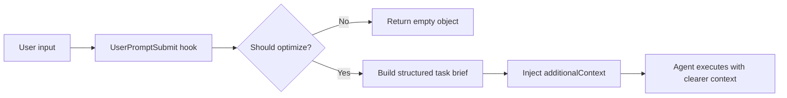

[English](./README_EN.md) | [中文](./README.md)

<div align="center">

# HookPrompt

**Turn casual requests into executable, verifiable prompts before an Agent starts work**

[](https://github.com/KimYx0207/Kim_Service)
[](https://github.com/KimYx0207/Kim_Service)
[](https://github.com/KimYx0207/Kim_Service)
[](https://github.com/KimYx0207/Kim_Service)
[](https://github.com/KimYx0207/Kim_Service)

</div>

## Overview

HookPrompt is a `UserPromptSubmit` hook for Claude Code, Codex, and similar Agent tools. It rewrites natural-language user input into a structured task brief before the model receives it.

It helps with three common failure modes:

- The user gives a fuzzy request, and the Agent does not know the real goal or acceptance criteria.
- The user gives short feedback such as "this does not work", "error", or "please check", but the actual intent is diagnosis or repair.
- The task needs scope, success criteria, and a verification plan before execution, otherwise the Agent may appear busy without proving the user goal is done.

By default, HookPrompt structures the task backstage. The visible response uses at most one brief sentence of understanding, with up to three short constraints only when needed, then immediately executes. Clear requests or requests for a direct answer can skip the preamble.

When the user explicitly asks to optimize, rewrite, create, or display a prompt, a complete copyable prompt is the deliverable and must not be replaced by a summary. Short confirmations retain the conversation's established goal, scope, and decisions.

Backstage guidance still uses role-first framing, outcome contracts, tagged structure, success criteria, and a verification plan. The original three-part display remains available through an explicit full mode.

## How It Works



HookPrompt does not execute the task itself. It clarifies intent, boundaries, output shape, and proof requirements before the Agent starts.

## Core Features

| Feature | Description |
|---|---|
| Structured optimization | Structures the task backstage, executes after at most brief understanding, and delivers complete prompts on request |
| Outcome contract | Adds goal, scope, success criteria, verification plan, and stop conditions |
| Smart filtering | Skips confirmations and ordinary built-in commands |
| Short diagnostic trigger | Still optimizes short repair-oriented input |
| Prompt-level governance entry | Keeps `/meta-theory ...` in the optimization path |
| Claude Code support | Provides `.claude/hooks/user-prompt-submit.js` and config examples |
| Codex support | Provides `.codex/hooks/user-prompt-submit.js` and `hooks.json` |
| Cross-platform | Node.js works on Windows, macOS, and Linux; Bash is available for macOS/Linux |

## Filtering Rules

| Input type | Optimized? |
|---|---|
| Claude Code built-in commands such as `/clear`, `/help`, `/commit` | No |
| Prompt-level governance entries such as `/meta-theory ...` | Yes |
| Short diagnostic or repair intent such as "this does not work", "error", "please check" | Yes |
| Short input without task intent | No |
| Simple confirmations such as "ok" or "continue" | No |
| Normal requirement descriptions | Yes |

## Quick Start

### 1. Verify in This Project

Run from the repository root:

```bash
node test-hook.js
```

The tests cover filtering, concise and full display modes, invalid-mode fallback, prompt-delivery guidance, Codex extraction, and privacy logging. When native Bash is available, they also execute its delegation entrypoint.

The entrypoints work in CommonJS and ESM projects. Copy the `.claude/hooks/user-prompt-submit.js` compatibility entry together with its adjacent `user-prompt-submit.cjs` implementation. The component-root `package.json` protects local tools inside the complete component; do not copy it over the target project's package or into a shared hooks directory.

### 2. Copy to a Claude Code Project

Copy `.claude` into the target project root:

```bash
cp -r .claude /your/project/root/
```

Windows PowerShell:

```powershell
Copy-Item -Recurse .claude D:\YourProject\
```

The target `.claude/settings.json` should use `UserPromptSubmit`:

```json
{
  "hooks": {
    "UserPromptSubmit": [
      {
        "hooks": [
          {
            "type": "command",
            "command": "node",
            "args": [".claude/hooks/user-prompt-submit.js"]
          }
        ]
      }
    ]
  }
}
```

### 3. Copy to a Codex Project

Place `.codex` together with its shared `.claude` implementation and template in the target project root. Merge existing configuration rather than overwriting it:

```bash
cp -r .codex .claude /your/project/root/
```

The Codex adapter delegates to the adjacent `.claude/hooks/user-prompt-submit.cjs`. That shared implementation extracts the `prompt` field from stdin JSON and returns model-visible context through `hookSpecificOutput.additionalContext`. Copying `.codex` alone or omitting `.cjs` is incomplete. Codex always reads stdin; the Claude entry retains its existing command-line argument input.

## Global Installation

### Claude Code

Windows PowerShell:

```powershell
New-Item -ItemType Directory -Force "$env:USERPROFILE\.claude\hooks" | Out-Null
Copy-Item -Force .claude\hooks\user-prompt-submit.js "$env:USERPROFILE\.claude\hooks\user-prompt-submit.js"
Copy-Item -Force .claude\hooks\user-prompt-submit.cjs "$env:USERPROFILE\.claude\hooks\user-prompt-submit.cjs"
Copy-Item -Force .claude\prompt-optimizer-meta.md "$env:USERPROFILE\.claude\prompt-optimizer-meta.md"
```

macOS / Linux:

```bash
mkdir -p ~/.claude/hooks
cp .claude/hooks/user-prompt-submit.js .claude/hooks/user-prompt-submit.cjs ~/.claude/hooks/
cp .claude/hooks/user-prompt-submit.sh ~/.claude/hooks/
cp .claude/prompt-optimizer-meta.md ~/.claude/
chmod +x ~/.claude/hooks/*.sh
```

Then configure `~/.claude/settings.json`. Absolute paths are more reliable for global installs:

```json
{
  "hooks": {
    "UserPromptSubmit": [
      {
        "hooks": [
          {
            "type": "command",
            "command": "node",
            "args": ["C:/Users/your-name/.claude/hooks/user-prompt-submit.js"]
          }
        ]
      }
    ]
  }
}
```

### Codex

Copy `.codex/hooks/user-prompt-submit.js` to your Codex hook directory, retain the adjacent shared `.claude` `.js`, `.cjs` and template using the Claude Code steps above, and merge `UserPromptSubmit` into `hooks.json`. Project installs need those files from both directories as well.

## Configuration

### Visible Display and Backstage Context

These settings are independent:

| Setting | Behavior |
|---|---|
| Unset or `HOOKPROMPT_DISPLAY_MODE=summary` | At most brief understanding then immediate execution; no repeated original input or expanded prompt, except when a prompt is the requested deliverable |
| `HOOKPROMPT_DISPLAY_MODE=full` | Restores original input, optimized understanding, and complete optimized prompt once in the first visible response |
| `HOOKPROMPT_COMPACT_CONTEXT=1` | Omits the shared method template to shorten backstage context; the selected visible display mode still applies |

Empty or unknown display values fall back to `summary`. Full mode still skips confirmations, ordinary commands, and internal messages. Neither setting changes host approvals, permissions, or governance stages.

To restore the original full display in the environment used to launch the host (PowerShell):

```powershell
$env:HOOKPROMPT_DISPLAY_MODE = "full"
```

On macOS / Linux:

```bash
export HOOKPROMPT_DISPLAY_MODE=full
```

Unset the variable or set it to `summary` to restore concise display. `HOOKPROMPT_COMPACT_CONTEXT=1` can be combined with either display mode.

### Customize Optimization Rules

Edit `.claude/prompt-optimizer-meta.md` to adjust:

- Task-role selection
- Goal, scope, and acceptance fields
- Output format
- Stop conditions for high-risk operations
- Examples and self-checks

## File Structure

```text
HookPrompt/
├── .claude/
│   ├── hooks/
│   │   ├── user-prompt-submit.js
│   │   ├── user-prompt-submit.cjs
│   │   └── user-prompt-submit.sh
│   ├── prompt-optimizer-meta.md
│   ├── settings.json
│   ├── settings.json.example-windows
│   └── settings.json.example-unix
├── .codex/
│   ├── hooks/
│   │   └── user-prompt-submit.js
│   └── hooks.json
├── docs/
│   └── images/
│       ├── contact-qr.png
│       ├── wechat-pay.jpg
│       └── alipay.jpg
├── CHANGELOG.md
├── LICENSE
├── README.md
├── README_EN.md
├── package.json
└── test-hook.js
```

## Testing

Run:

```bash
node test-hook.js
```

Run the tests after changing hook logic, filtering rules, Codex adaptation, or the prompt template. Test processes isolate inherited HookPrompt mode and debug settings so default-mode cases stay deterministic.

Passing tests prove local script behavior. To verify real product behavior, trigger the hook in Claude Code or Codex.

## Troubleshooting

### Hook Not Executing

Check:

1. The settings key must be `UserPromptSubmit`, not `user-prompt-submit`.
2. The hook value must be an array.
3. The command entry must include `type: "command"`.
4. `node -v` must work.
5. Restart Claude Code or reopen the relevant session after configuration changes.

### Windows Cannot Find the Script

Use absolute paths with `/` or escaped `\\`:

```json
"args": ["C:/Users/your-name/.claude/hooks/user-prompt-submit.js"]
```

### Returning `{}` Does Not Mean Installation Failed

HookPrompt intentionally skips short text without a clear task, such as "test", "test input", or "ok". Returning `{}` is expected in that case. Do not use those words as a positive acceptance test, remove the hook, or downgrade Node.js because of this result.

On Windows PowerShell, test with a real task sentence:

```powershell
'{"hook_event_name":"UserPromptSubmit","prompt":"Please organize these quotations for me"}' |
  node "$env:USERPROFILE\.claude\hooks\user-prompt-submit.js"
```

If the output contains `hookSpecificOutput` and `additionalContext`, the script and input protocol are working. Fully exit and reopen Claude Code, then enter the same sentence to verify the real `UserPromptSubmit` event. Running `node user-prompt-submit.js "test"` is not a valid test because the hook reads event JSON from standard input, not from that positional argument.

### Optimization Does Not Appear

Possible reasons:

- The input was classified as a confirmation or ordinary command.
- The hook returned `{}` to skip optimization.
- The host tool does not render `additionalContext` as visible output.

Try a clearer task input:

```text
Build a login feature with tests and error handling
```

### Logs

No log is created by default. Enable temporary debug logging only while diagnosing the hook itself. Debug records contain event names and lengths; they never contain raw input, user input, derived prompts, or exception bodies.

Windows:

```powershell
$env:HOOKPROMPT_DEBUG = "1"
# Trigger the hook once, then inspect:
Get-Content "$env:TEMP\hookprompt-debug\hook-prompt-optimizer.log"
```

macOS / Linux:

```bash
HOOKPROMPT_DEBUG=1 claude
# Trigger the hook once, then inspect:
cat "${TMPDIR:-/tmp}/hookprompt-debug/hook-prompt-optimizer.log"
```

Debug logs rotate at 64 KiB, keep at most three archives for seven days, and reject paths outside the temporary directory as well as symlink/junction log directories. Unset `HOOKPROMPT_DEBUG` after diagnosis to return to fully disabled logging.

## Changelog

Release history is maintained in [CHANGELOG.md](./CHANGELOG.md). The changelog is written in Chinese.

## Contact

<p align="center">
  
</p>

GitHub <a href="https://github.com/KimYx0207">KimYx0207</a> |
X <a href="https://x.com/KimYx0207">@KimYx0207</a> |
Website <a href="https://www.aiking.dev/">aiking.dev</a> |
WeChat Official Account: <strong>老金带你玩AI</strong>

Feishu knowledge base:
<a href="https://my.feishu.cn/wiki/OhQ8wqntFihcI1kWVDlcNdpznFf">long-term update entry</a>

### Buy Me a Coffee

If HookPrompt helps you, you can support ongoing maintenance.

<table align="center">
<tr><th>WeChat Pay</th><th>Alipay</th></tr>
<tr>
<td align="center"></td>
<td align="center"></td>
</tr>
</table>

## Contributing

Issues and PRs are welcome. Please keep three boundaries:

1. Do not treat longer prompts as the quality goal.
2. Do not treat command success as user-goal completion.
3. Do not use externally hosted contact or payment QR links when repository-local assets are available.

## License

MIT License. See [LICENSE](./LICENSE).
